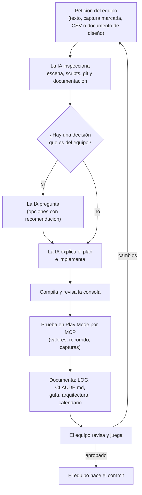

# Uso de inteligencia artificial en Mictlán (TD_Game)

**Proyecto:** Mictlán, videojuego 2D top-down en Unity 6 (Micta Forge)
**Periodo cubierto:** 14 de octubre al 26 de noviembre de 2026
**Última actualización:** 26 de noviembre de 2026
**Relacionado:** `CLAUDE.md` (reglas que sigue la IA) · `DEVELOPMENT_LOG.md` (registro de sesiones) · `DEVELOPMENT_CALENDAR.md` (plan y estado)

Este documento explica **qué herramientas de IA se usaron, para qué, quién las dirigió, cómo se revisó su trabajo, qué errores cometieron y qué límites tienen**. Distingue siempre entre lo **confirmado** (con evidencia en el repositorio o en la conversación de trabajo) y lo que **el equipo debe confirmar**.

---

## Índice

1. [Resumen](#1-resumen)
2. [Herramientas](#2-herramientas)
3. [Reglas de uso](#3-reglas-de-uso)
4. [Cómo se trabajó con la IA](#4-cómo-se-trabajó-con-la-ia)
5. [Registro por sesión](#5-registro-por-sesión)
6. [Qué hizo la IA y qué hizo el equipo](#6-qué-hizo-la-ia-y-qué-hizo-el-equipo)
7. [Verificación del trabajo de la IA](#7-verificación-del-trabajo-de-la-ia)
8. [Errores e incidentes de la IA](#8-errores-e-incidentes-de-la-ia)
9. [Limitaciones conocidas](#9-limitaciones-conocidas)
10. [Datos, privacidad y seguridad](#10-datos-privacidad-y-seguridad)
11. [Originalidad, arte y propiedad intelectual](#11-originalidad-arte-y-propiedad-intelectual)
12. [Lecciones aprendidas](#12-lecciones-aprendidas)
13. [Pendiente de confirmar por el equipo](#13-pendiente-de-confirmar-por-el-equipo)
14. [Cómo mantener este documento](#14-cómo-mantener-este-documento)

---

## 1. Resumen

- **Asistente principal:** Claude, de Anthropic, usado a través de **Claude Code** (aplicación de escritorio), conectado al editor de Unity con **MCP for Unity**.
- **Papel de la IA:**
  - programar sistemas en C# y herramientas de editor;
  - construir escenas, generar arte y sonido por código;
  - probar en Play Mode;
  - escribir y mantener la documentación.
- **Papel del equipo:**
  - decidir el diseño, el alcance y la arquitectura;
  - diseñar el mapa (CSV y bocetos) y hacer arte propio;
  - jugar y pedir cambios;
  - revisar los resultados y hacer los commits.
- **Reconocimiento dentro del juego:** los créditos (`UI/CreditsScreen.cs`) incluyen «Claude — AI assistant by Anthropic · programming · procedural art · sound». El menú principal (`UI/TitleMenu.cs`) dice «With the help of Claude, an AI assistant by Anthropic».
- **Control humano:** la IA no decide sola los cambios grandes. Pregunta las decisiones de arquitectura, no hace commits salvo que se le pida en ese momento y documenta cada sesión.

**Cifras del proyecto al 26 nov** (no todo es trabajo de la IA; ver §6):

| Qué | Cantidad |
|---|---|
| Scripts C# en `Assets/TD_Game/Scripts/` | 137 archivos, unas 21 900 líneas |
| Herramientas de editor (`Scripts/Editor/`) | 31 archivos, unas 9 400 líneas |
| Documentos del proyecto (`*.md` en la raíz) | 8 (este incluido) |
| Sesiones en `DEVELOPMENT_LOG.md` | 25 numeradas (más 1b, 1c y 24b) |

---

## 2. Herramientas

### 2.1 Herramientas de IA generativa

| Herramienta | Versión o modelo | Para qué se usó | Evidencia |
|---|---|---|---|
| **Claude Code** (app de escritorio de Anthropic, pestaña *Code*) | Modelos **Claude Opus 5.5** y **Claude Sonnet 5.5**; el usuario cambió de modelo con `/model` durante el trabajo | Leer y escribir archivos del repositorio, ejecutar comandos (git, PowerShell, Bash), controlar Unity por MCP, escribir documentación | Conversación de trabajo de Adrián; commits con `Co-Authored-By: Claude Opus 5.5` (ver §5) |
| **MCP for Unity** (`com.coplaydev.unity-mcp`) | Rama `#main` del repositorio de CoplayDev, sin versión fija; servidor HTTP local en `127.0.0.1:8080` | Puente entre Claude y el editor: ejecutar C# en el editor, leer la consola, abrir y guardar escenas, compilar, entrar en Play Mode | `Packages/manifest.json`; sesiones 1–4, 7–12, 22 y 25 del registro |

**Herramientas de MCP más usadas:**
- `execute_code`: ejecutar C# dentro del editor, para construir escenas, probar y medir;
- `read_console`;
- `manage_scene`;
- `manage_editor` (Play, Stop);
- `refresh_unity` (compilar);
- `execute_menu_item`;
- `manage_packages`;
- `manage_camera`.

### 2.2 Herramientas automáticas que no son IA generativa

| Herramienta | Uso | Nota |
|---|---|---|
| **Texto a voz de Windows** (System.Speech) | Voces del comerciante (`Audio/VoiceRaw~`), procesadas después con `SfxSynth` | Síntesis de voz local del sistema operativo. No es un modelo generativo en la nube. El registro lo indica en las sesiones 24 y 24b |
| **Generadores procedurales del proyecto** (`PixelCanvas`, `PropArt`, `TerrainArt`, `SfxSynth`, `ButtonGlyphs`…) | Pixel art, tiles, iconos y efectos de sonido generados por código C# dentro de Unity | El **código** lo escribió la IA a petición del equipo; el arte resultante es determinista (sale de ese código), no de un modelo de imágenes |

### 2.3 Herramientas que **no** se usaron

No hay evidencia en el repositorio del uso de:
- modelos de generación de imágenes, música o voz en la nube;
- otros asistentes de código (Copilot, ChatGPT, Codex, Gemini…).

Si alguien del equipo los usó, debe añadirlo en §13.

**Prohibición expresa:** por decisión del equipo del 3 de noviembre (`CLAUDE.md` §14), no se usa Python ni generadores externos. Todo se hace dentro de Unity con C# (JSON permitido).

---

## 3. Reglas de uso

Las reglas están en `CLAUDE.md`, que Claude Code carga automáticamente al empezar cada sesión. Las más importantes para el uso de IA:

| Regla | Origen | Por qué |
|---|---|---|
| **La IA no hace commits ni push** salvo que el usuario lo pida en ese momento | `CLAUDE.md` §14 (3 nov) | El equipo revisa todo antes de subirlo |
| Antes de cambiar algo: inspeccionar el proyecto, explicar qué se va a modificar y por qué | `CLAUDE.md` §10 | Evitar cambios a ciegas |
| **Detenerse y pedir autorización** si una operación puede eliminar trabajo existente | `CLAUDE.md` §10 | Proteger el trabajo del equipo |
| No sobrescribir escenas existentes; crear escenas nuevas o de prueba | `CLAUDE.md` §10 | `MainMap`, `ZonaDeValles` y `MainMap_CSV` se crearon como escenas nuevas |
| Después de cada etapa: compilar, revisar la consola, validar referencias, probar en Play Mode y **documentar** | `CLAUDE.md` §10 | Cada sesión deja su entrada en `DEVELOPMENT_LOG.md` |
| Preguntar las decisiones de arquitectura (no decidir sola) | Instrucción inicial del equipo (3 nov) | Decisiones D1–D6 y P0–P4 del calendario |
| Sin Python ni generadores externos | `CLAUDE.md` §14 | Que todo el proyecto se pueda mantener desde Unity |
| El juego anterior (Mictlán v5) no se modificaba; solo se copiaban y adaptaban sus sistemas | `CLAUDE.md` §13–14 | Conservar la referencia. El 26 nov el equipo lo borró (commit `0d35fc4`) |
| Datos personales del equipo (correos, nombres) no se envían a servicios externos | Configuración de Claude Code | Privacidad (§10) |

---

## 4. Cómo se trabajó con la IA

### 4.1 Flujo típico de una sesión



### 4.2 Tipos de petición que mejor funcionaron

- **Capturas marcadas a mano:**
  - la revisión del mapa del 26 nov se pidió con una captura con líneas de colores (verde = límite, rojo = quitar, rosa = mover, blanco = árboles, gris = rocas);
  - la IA convirtió los trazos a celdas del CSV (1 celda = 13,3 px de la captura) y comprobó cada línea contra caminos y ríos antes de aplicarla.
- **Documentos de diseño:**
  - `zona_de_valles_mictlan.md` y su boceto (19 nov);
  - `instrucciones_de_mapa_y_combate_para_claude.md` (sesión 22, Toño).
- **Datos estructurados:** el CSV del mapa (`Settings/Maps/mapa_juego_150x70.csv`), editable por el equipo y leído por las herramientas de editor.
- **Decisiones cerradas por el equipo en un formato fijo**, por ejemplo «D1 A / D2 Muévelo / D3 Instálalos».

### 4.3 Patrón técnico elegido: herramientas de editor que regeneran escenas

Gran parte del mundo se construye con **herramientas de editor** escritas por la IA:
- `CsvMapBuilder`, `V09WorldUpgrade`, `CombatHUDBuilder`, `FrontEndBuilder`, `MainMapBuilder`…;
- se ejecutan desde el menú **TD_Game** y dejan escenas normales de Unity.

**Ventajas:**
- los cambios son reproducibles y quedan en el código;
- el equipo puede cambiar el diseño (por ejemplo, el CSV) y regenerar.

**Costo:**
- los cambios hechos a mano en objetos generados se pierden al regenerar;
- por eso la guía (`TD_Game_GUIA.md` §3) indica qué no editar a mano.

`CLAUDE.md` §3 pide justificar la generación de niveles por código. La justificación quedó registrada en las sesiones 22, 24 y 25: el equipo diseña en un CSV y el editor lo traduce a Tilemaps nativos.

---

## 5. Registro por sesión

**Leyenda de la evidencia:**
- **C** = conversación de trabajo con Claude Code (de Adrián), que generó este documento;
- **T** = commit con la línea `Co-Authored-By: Claude`;
- **R** = el registro dice explícitamente que se usó MCP o Claude;
- **?** = sin evidencia en el repositorio: lo debe confirmar quien hizo la sesión (§13).

| Fecha | Sesión / commit | Quién dirigió | Qué hizo la IA | Evidencia |
|---|---|---|---|---|
| 14–15 oct | Integración de Mictlán v5 · commits `c1e1434`, `b58fd82` (midterm2), `fb0abea` | Adrián | Comprobó la conexión MCP; creó cubos de prueba; integró el proyecto Mictlán v5 descargado en el repositorio (reemplazo completo, aprobado por el usuario); escribió `ARQUITECTURA.md` y un PDF de presentación; hizo los commits y el push **a petición expresa** del usuario («haz commit… y push») | C, T |
| 3 nov | Sesiones 1, 1b, 1c | Adrián | Diagnóstico del proyecto (11 problemas); `DEVELOPMENT_CALENDAR.md` y `DEVELOPMENT_LOG.md`; preguntó las decisiones D1–D6; instaló `com.unity.2d.tilemap` y `com.unity.2d.sprite` por MCP; replanificó a **top-down** cuando el equipo cambió de idea | C, R |
| 3 nov | Sesiones 2–4 | Adrián | Base de TD_Game: estructura de carpetas, `PlayerControls.inputactions`, primitivas y tiles placeholder, Tile Palette, `TestLevel`, Grid con 3 Tilemaps, `CameraFollow`, `PlayerInputReader`, `PlayerMovement`; `TD_Game_ARQUITECTURA.md` y `TD_Game_GUIA.md` | C, R |
| 5 nov | Sesiones 5–6 | Adrián | Reorganizó el calendario (arte en Aseprite, mapa principal) y lo replanificó cuando el alcance pasó de prototipo a **juego final** (metas M1–M8, hitos H1–H4, plan de adaptación del juego anterior) | C, R |
| 10 nov | Commit `c1845e6` | Adrián | Commit del equipo con el trabajo de las sesiones anteriores | Commit sin firma; el contenido es de las sesiones C |
| 12–13 nov | Sesiones 7–12 · commits `0af31f9`, `f74db93`, `55c36a9` | Toño | Jugador en 8 direcciones y combate por turnos completo; salto, orbes, Tonalli, críticos y combos; HUD en Canvas; sprint; menú estilo JRPG; paleta mexica; estética más oscura | R («validada en Play Mode por MCP») |
| 15–17 nov | Sesiones 13–17 · commits `fae986f`, `d893ef9` | Alex | Enemigos con IA, jefe, guardado, Game Over, menús, audio, `MainMap`, tiendas, minimapa, gore, cómic, primer .exe | ? (los créditos atribuyen a Claude «programming · procedural art · sound») |
| 17 nov | Sesiones 18–20 · commit `20f7d53` | Toño | Animación procedural del combate, `MacuahuitlRig`, paso a la rama `v0.6` | ? (el registro dice «validada en Play Mode con secuencias de capturas», sin nombrar la herramienta) |
| 19 nov | Sesión 21 · commit `82faf32` | Alex | QTE, mando, dificultad, templo, cómic y outro | ? |
| 19 nov | Nivel «Zona de Valles» (sin número de sesión en esta rama) | Adrián | Escena `ZonaDeValles` a partir de `zona_de_valles_mictlan.md` y su boceto: herramienta `ValleysMapBuilder`, arte provisional (`ValleysArt`), aura de luz, puertas a interiores, piedras para saltar, rescate del NPC y cofre del arma. **No llegó a la rama:** el equipo eligió el mapa del CSV (24 nov). Se conserva en un *stash* de GitHub Desktop (`stash@{0}`) | C |
| 24 nov | Sesiones 22–23 · commit `19d966d` | Toño | Mapa desde el CSV (`MainMap_CSV`), esquiva de una tecla, iconos por dispositivo, auditoría | T, R («Siguiendo `instrucciones_de_mapa_y_combate_para_claude.md`») |
| 25 nov | Sesiones 24 y 24b · commit `4eb39fb` | Alex / equipo | v0.9: peligros con caída, puentes, pirámide, NPC, tiendas, skins, misión de las brujas, mapa completo, self-test automático (49/49); créditos a Claude | R (créditos añadidos en la 24b); confirmar autoría (§13) |
| 26 nov | Commits `0d35fc4` y `6cd4291` | Alex / Toño | Limpieza del juego anterior; documentación v0.6 reescrita | `6cd4291`: T; `0d35fc4`: ? |
| 26 nov | Sesión 25 | Adrián | Análisis de `MainMap_CSV`; revisión del mapa desde una captura marcada (límites, pirámide aparte, casa de las brujas, barreras, enemigos, tienda); arreglos del minimapa y del mapa completo; actualización de toda la documentación y este archivo | C |

---

## 6. Qué hizo la IA y qué hizo el equipo

### 6.1 Trabajo de la IA (bajo dirección del equipo)

| Área | Ejemplos concretos |
|---|---|
| **Código de juego (C#)** | Movimiento, cámara, combate por turnos dividido en componentes, habilidades como ScriptableObjects, orbes, guardado, puertas, peligros, diálogos, mapa completo |
| **Herramientas de editor** | Constructores de escenas y HUD, generadores de arte (`PixelCanvas`, `PropArt*`, `TerrainArt`), lector y pintor del CSV, actualización v0.9 y diseño del mapa (`V09WorldUpgrade.Layout.cs`) |
| **Arte procedural** | Tiles, props, efectos, iconos de botones e interiores generados por código, siempre con la paleta `MexicaPalette` |
| **Sonido** | Efectos sintetizados por código (`SfxSynth`); procesado de las voces de texto a voz |
| **Pruebas** | Validación en Play Mode por MCP, recorrido por inundación con las colisiones reales para comprobar qué se puede alcanzar, self-test automático (`V09SelfTest`) |
| **Documentación** | `CLAUDE.md`, `DEVELOPMENT_CALENDAR.md`, `DEVELOPMENT_LOG.md`, `TD_Game_ARQUITECTURA.md`, `TD_Game_GUIA.md`, `README.md`, este archivo |
| **Git** | Lectura del estado, cambio de rama (`git switch v0.6`, a petición), diagnóstico del certificado SSL (`http.sslBackend=schannel`). Commits **solo** cuando se pidió (octubre) |

### 6.2 Trabajo del equipo

| Área | Ejemplos concretos |
|---|---|
| **Dirección y decisiones** | Cambio a top-down (3 nov), juego final en vez de prototipo (5 nov), estética mexica seria y oscura (13 nov), mapa del CSV como mapa principal (24 nov), límites y pirámide aparte (26 nov) |
| **Diseño** | El CSV del mapa (150 × 70 celdas), el documento y el boceto de «Zona de Valles», la colocación de campamentos y tiendas, las capturas marcadas con lo que había que cambiar |
| **Arte propio** | Arte del equipo (`Art/Environment/Team`), arte de Vely (`Art/Tilesets/Vely`), pixel art de los personajes de Mictlán v5 |
| **Pruebas de juego** | Jugar las versiones y reportar errores (por ejemplo, el minimapa que no volvía al salir de una casa) |
| **Control de versiones** | Los commits desde el 10 nov los subió el equipo; dos llevan la firma `Co-Authored-By: Claude` (`19d966d`, `6cd4291`) porque se prepararon con Claude Code |

**Sobre la autoría del código:** no se midió línea por línea qué escribió la IA y qué el equipo. Los créditos del juego atribuyen a Claude la programación, el arte procedural y el sonido, y al equipo la dirección, el diseño y el arte propio. Ver §13.

---

## 7. Verificación del trabajo de la IA

Cada cambio se verificó con estos pasos (registrados en `DEVELOPMENT_LOG.md`):

1. **Compilación:** `refresh_unity` y lectura de la consola. Se revisan las advertencias de `TD_Game`; las del juego anterior se ignoraban por decisión del 3 nov.
2. **Referencias:** lectura de componentes y campos serializados con `execute_code`.
3. **Play Mode por MCP:**
   - mover al jugador, cruzar puertas, provocar combates y leer valores (vida, modo de juego, posición, cámara);
   - ejemplo de la sesión 25: entrar a la pirámide; ver que la puerta de obsidiana sin llave dice «The door is sealed»; abrirla con la llave (con su escena de apertura); salir a la cima; comprobar que el minimapa vuelve.
4. **Capturas:** vistas generales del mapa renderizadas con una cámara temporal y capturas de Play Mode con `ScreenCapture`, revisadas por la IA y enviadas al equipo.
5. **Pruebas de recorrido:**
   - inundación desde el inicio con las colisiones reales de Unity, para comprobar que se alcanza todo lo importante;
   - en la sesión 25: 36 enemigos, 4 cofres, tiendas, NPC y puertas alcanzables, y las zonas cerradas inalcanzables.
6. **Self-test automático:** **TD_Game > v0.9 > Run Self Test** juega solo con un teclado virtual (49/49 en la sesión 24).
7. **Revisión humana:** el equipo juega la versión y decide si se sube.

---

## 8. Errores e incidentes de la IA

Registro honesto de los fallos de la IA durante el proyecto, para que se entienda el nivel de supervisión que necesita.

| Fecha | Error | Impacto | Cómo se detectó y corrigió |
|---|---|---|---|
| 3 nov | Usó **Python** para editar documentos después de que el equipo lo prohibiera | Incumplió una regla del equipo (sin daño en el proyecto) | Se corrigió el método (solo herramientas de edición); la regla quedó en la memoria de Claude |
| 3 nov | Dijo que unas carpetas vacías **no tenían `.meta`**, y sí los tenían (se borraron también) | Información incorrecta al equipo | Se reconoció y se corrigió el informe |
| 3 nov | Escribió en la guía una ruta de menú que **no existe en Unity 6** («Create > 2D > Tiles > Tile») | La guía daba un paso imposible | Se cambió por arrastrar sprites a la Tile Palette |
| 19 nov | Las pruebas de «Zona de Valles» **sobrescribieron la partida guardada local** (Continue) | Se perdió la partida de prueba del usuario | Se avisó al usuario en el informe de la sesión |
| 26 nov | Un script de prueba enviado a Unity tenía un **bucle infinito** al trazar líneas horizontales y **congeló Unity** | El editor quedó bloqueado unos minutos; el usuario tuvo que cerrarlo a la fuerza. No se perdió nada: la escena no tenía cambios sin guardar y el CSV no se había escrito | Se reconoció de inmediato; se reescribió el trazado con un número de pasos acotado |
| 26 nov | Al recortar el mapa, la zona «Valley of Serpents» **se movió por error** junto con el interior de la pirámide | En el mapa completo (M) los nombres aparecían fuera del mapa | El usuario lo reportó con una captura; se corrigió el código y se regeneró |
| 26 nov | Al mover los interiores a salas aparte, el mapa completo (M) **los dibujaba fuera del mapa** | Quetzalcóatl y «Celestial Temple» salían en el borde izquierdo | Lo que hay dentro de una sala se dibuja ahora en su puerta exterior (`HouseDoor.OutsidePositionOf`) |
| Antes del 26 nov | El texto de los glifos de la pirámide tenía **acentos mal codificados** («Mictlán») | Texto roto dentro del juego | La IA lo detectó al editar ese archivo en la sesión 25 y lo corrigió |

**Fallos de herramientas (no de la IA):**
- el servidor MCP se desconectó varias veces y había que reiniciarlo y reconectarlo;
- la captura de MCP sacaba a Unity de Play Mode;
- una escritura de imagen falló con un archivo bloqueado por Windows y se reintentó;
- las comprobaciones de seguridad de MCP bloquearon el borrado de una escena desde código, y la IA buscó otra forma de hacerlo en lugar de desactivarlas.

---

## 9. Limitaciones conocidas

- **No sabe si el juego es divertido:** la IA comprueba que algo funciona, pero el ritmo, la dificultad y la sensación las juzga el equipo jugando. Ejemplo: la duración de al menos 10 minutos (meta M5) está pendiente de medir en un playtest.
- **El timing no se puede probar por MCP:** la latencia impide acertar las ventanas de crítico y de esquiva (sesión 8). Se probaron con teclado real.
- **Unity en segundo plano:** el Play Mode avanza a saltos. En las pruebas hay que activar `Application.runInBackground` y esperar por estado, no por tiempo.
- **La IA no ve la pantalla del usuario:** trabaja con capturas que genera ella o que le envía el equipo.
- **Puede equivocarse con seguridad aparente:** ver §8. Por eso todo lo importante se verifica en Unity.
- **El paquete MCP no tiene versión fija** (`#main`): una actualización podría romper la conexión.
- **Contexto limitado:** en sesiones largas, la conversación se resume y se pierden detalles. Por eso las decisiones se escriben en `CLAUDE.md` y en el registro, no solo en el chat.

---

## 10. Datos, privacidad y seguridad

- **Qué recibe la IA:**
  - el contenido del repositorio que lee, los mensajes del equipo y las imágenes adjuntas;
  - todo esto se procesa en los servidores de Anthropic a través de Claude Code.
- **Datos personales:**
  - Claude Code está configurado para no enviar el correo ni otros datos del usuario a servicios externos;
  - no hay datos personales de jugadores en el juego: la partida se guarda en local (`Application.persistentDataPath`).
- **Acciones con riesgo:**
  - borrar escenas, forzar cambios en git o cerrar procesos requiere confirmación del usuario;
  - el commit y el push de octubre se hicieron porque el usuario lo pidió expresamente;
  - el *stash* de GitHub Desktop con «Zona de Valles» se revisó sin aplicarlo ni borrarlo.
- **Archivos descargados:** el proyecto Mictlán v5 se integró desde una carpeta descargada por el equipo, a petición del usuario.

---

## 11. Originalidad, arte y propiedad intelectual

- **Arte generado por código:**
  - lo produce código C# del propio proyecto (formas, colores y texturas píxel a píxel);
  - no se usaron bancos de imágenes ni modelos de imagen.
- **Inspiraciones nombradas por el equipo:**
  - God of War clásico (orbes);
  - JRPG modernos (menú de combate);
  - *Clair Obscur: Expedition 33* (esquiva de un botón);
  - Hollow Knight (luz propia, en «Zona de Valles»);
  - Resident Evil 4 (tienda).
  - Se tomaron como **referencia de mecánicas y estilo**. `CLAUDE.md` exige no copiar arte de ningún juego.
- **Recursos de terceros:**
  - fuente **Pirata One**, con licencia SIL OFL; la licencia va incluida en `Art/Fonts/PirataOne-OFL.txt`;
  - arte de Vely y arte del equipo (autoría humana).
- **Mitología:** los nombres y motivos mexicas (Mictlán, Tonalli, Teyolia, Ihiyotl, Quetzalcóatl, Cihuateotl, Quinametzin…) los propuso el equipo. La IA los usó en textos y diseño.
- **Reconocimiento:** Claude aparece en los créditos y en el menú principal como asistente de IA.

---

## 12. Lecciones aprendidas

1. **Un archivo de reglas (`CLAUDE.md`) cargado en cada sesión** evitó que la IA olvidara decisiones del equipo: sin commits, sin Python, sin tocar el juego anterior.
2. **Escribir las decisiones, no solo decirlas.** Cuando el contexto de la conversación se resume, lo que no está en los documentos se pierde.
3. **Pedir con capturas marcadas** fue la forma más rápida y precisa de explicar cambios de mapa.
4. **Generar escenas con herramientas de editor** hace los cambios reproducibles, pero obliga a cambiar el código, no la escena. Hay que avisarlo en la guía.
5. **Verificar siempre en Unity:** los errores de §8 se detectaron al compilar, al probar o porque el equipo jugó.
6. **El código que la IA ejecuta en el editor también necesita cuidado:** un bucle sin límite congeló Unity. Los bucles de prueba deben tener un número de pasos acotado.
7. **Pedir confirmación antes de borrar** protegió trabajo real: la escena «Zona de Valles» sobrevive en un *stash*.

---

## 13. Pendiente de confirmar por el equipo

Este documento solo afirma lo que tiene evidencia. Cada persona debe completar su parte:

| Pregunta | Quién | Respuesta |
|---|---|---|
| ¿Las sesiones 13–17 y 21 (enemigos, jefe, menús, audio, `MainMap`, QTE…) se hicieron con Claude u otra IA? ¿Con qué modelo? | Alex | _pendiente_ |
| ¿La sesión 24 (v0.9) y el commit `0d35fc4` se hicieron con IA? | Alex | _pendiente_ |
| ¿Las sesiones 7–12 (el registro dice «por MCP») y 18–20 usaron Claude Code? ¿Con qué modelo? | Toño | _pendiente_ |
| ¿El boceto y la imagen de concepto de «Zona de Valles» se hicieron a mano o con una herramienta de IA? | Autor del documento de diseño | _pendiente_ |
| ¿El CSV del mapa (`mapa_juego_150x70.csv`) se diseñó a mano o con ayuda de IA? | Autor del CSV | _pendiente_ |
| ¿Se usó alguna otra IA (ChatGPT, Copilot, generadores de imagen o música) en algo que esté en el juego? | Todo el equipo | _pendiente_ |
| ¿Qué porcentaje aproximado del código considera el equipo que escribió la IA? | Todo el equipo | _pendiente_ |

---

## 14. Cómo mantener este documento

- Al terminar una sesión de trabajo con IA, añade una fila en §5 con la fecha, la sesión o el commit, quién la dirigió, qué hizo la IA y la evidencia.
- Si la IA comete un error relevante, añádelo en §8 con su impacto y cómo se corrigió.
- Si se usa una herramienta nueva, añádela en §2.
- Al hacer un commit con ayuda de Claude Code, conserva la línea `Co-Authored-By: Claude …`: es la evidencia más fácil de rastrear (`git log --grep="Co-Authored-By: Claude"`).

**Plantilla de fila (§5):**

```
| AAAA-MM-DD | Sesión N · commit abc1234 | Nombre | Qué pidió el equipo y qué hizo la IA (archivos, sistemas) | C / T / R / ? |
```
