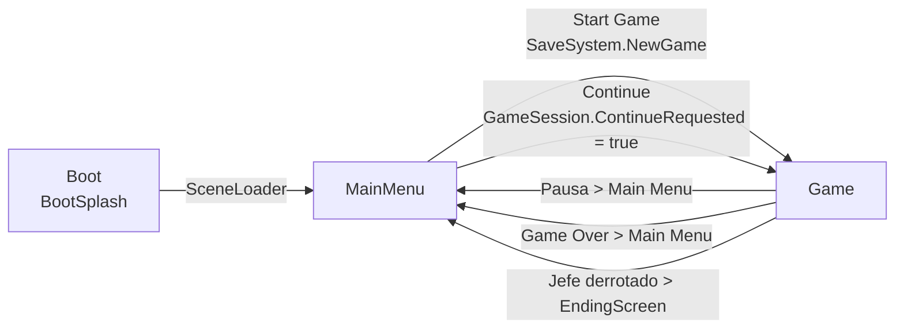
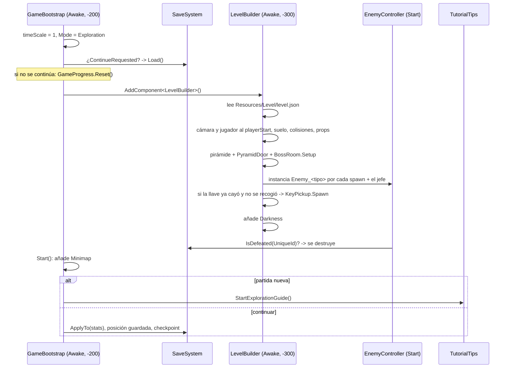
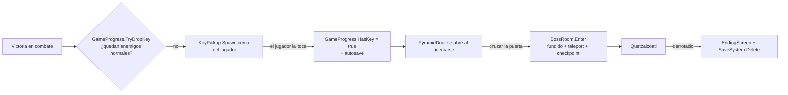
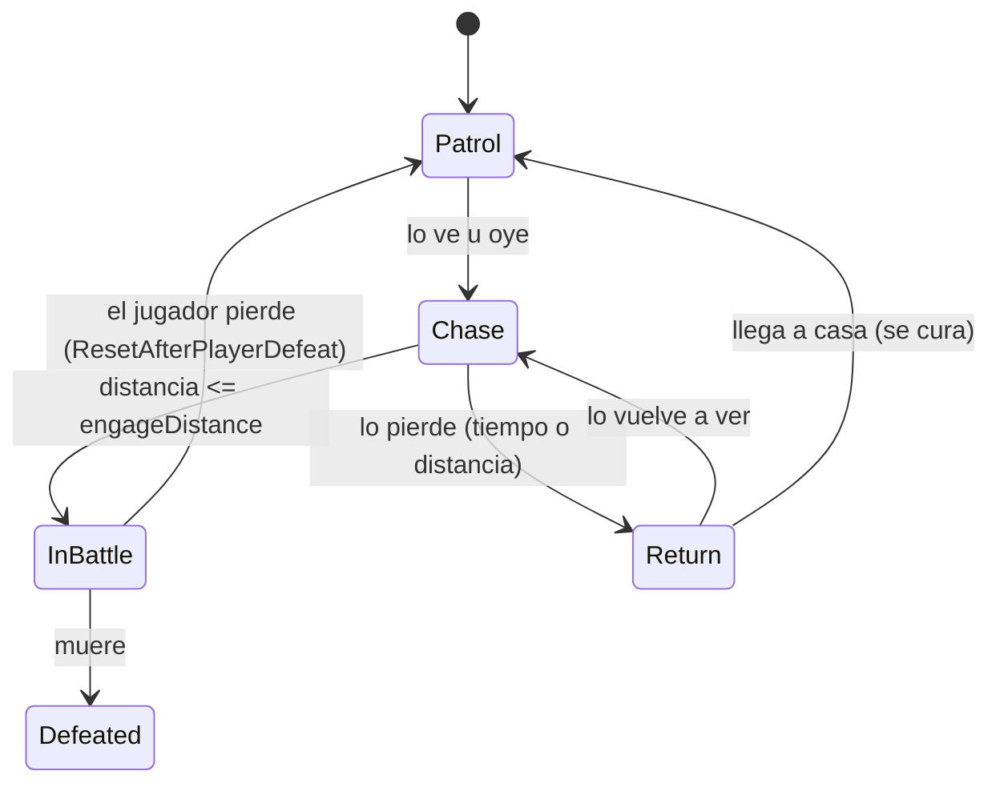
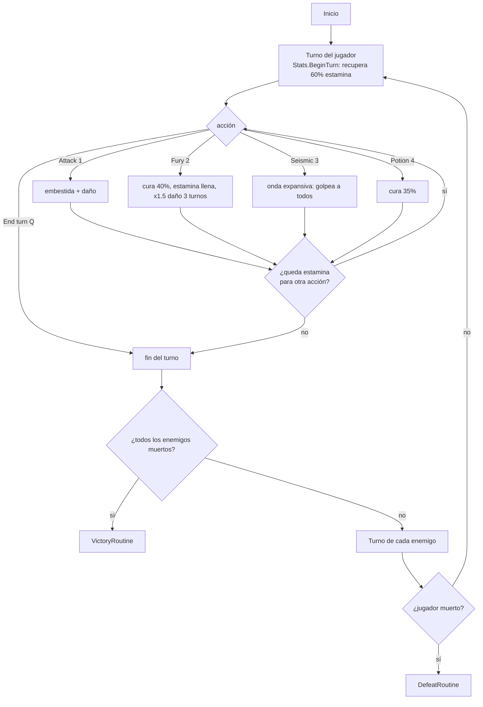

# Mictlán: cómo funciona el juego por dentro

Este documento explica **cada sistema del juego y cómo se conectan entre sí**. Es complementario al
[README.md](README.md), que cubre controles, cómo abrir el proyecto y qué valores ajustar.

> Rutas de código relativas a `Assets/Scripts/`. Todas las distancias están en **tiles** (1 unidad = 1 tile = 16 px).

---

## 1. Idea general

El juego está construido casi por completo **en código**. Las escenas contienen muy poco:

| Escena | Contenido en el editor | Qué crea en tiempo de ejecución |
|---|---|---|
| `Boot` | Cámara + `BootSplash` | Pantallas de logo, clasificación y aviso legal |
| `MainMenu` | Cámara + `MainMenu` | Título, menú principal, opciones, créditos |
| `Game` | Cámara (`CameraFollow2D`), prefab `Tlahuelli`, objeto `GameBootstrap` (+ `PauseMenu`) | **Todo el nivel**: suelo, ríos, árboles, pirámide, enemigos, minimapa, oscuridad, HUD de combate… |

Los datos que definen el contenido viven en `Assets/Resources/` y se cargan por nombre con `Resources.Load`:

```
Resources/
  Level/level.json      -> forma del mapa, obstáculos, props y posición de cada enemigo
  Sprites/*.png         -> todo el pixel art (personajes, props, sangre, llave, puerta…)
  Enemies/*.asset       -> EnemyData: estadísticas, ataques, IA y recompensas de cada enemigo
  Enemies/Enemy_*.prefab-> prefab de cada tipo de enemigo (apunta a su EnemyData)
  Audio/*.wav           -> efectos y música
  UI/MenuBackground.png -> fondo del menú
```

Gracias a esto, **se puede cambiar el mapa, el arte, el audio o el balance sin tocar código**: basta con reemplazar el archivo
con el mismo nombre (ver `Tools/` para los generadores).

---

## 2. Mapa de sistemas

```mermaid
flowchart TD
    subgraph Core["Core (estado global)"]
        GS[GameState<br/>modo: Exploration / Combat / Paused / Cutscene]
        SS[SaveSystem<br/>PlayerPrefs]
        GP[GameProgress<br/>llave, jefe, enemigos muertos]
        DIF[Difficulty]
        SL[SceneLoader]
    end

    subgraph World["Mundo"]
        GB[GameBootstrap] --> LB[LevelBuilder]
        LB --> HZ[Hazards<br/>agua y fosos]
        LB --> PD[PyramidDoor]
        LB --> BR[BossRoom]
        LB --> DK[Darkness]
        LB --> EN[Enemigos<br/>EnemyController]
        KP[KeyPickup]
    end

    subgraph Player["Jugador"]
        P2D[Player2D] --> FH[FakeHeight]
        PCS[PlayerCombatStats]
        HP[Health]
    end

    subgraph Combat["Combate"]
        BM[BattleManager] --> HUD[BattleHUD]
        BM --> BCAM[BattleCameraController]
        BM --> BI[BattleInput]
        BM --> GO[GameOverScreen]
        BM --> END[EndingScreen]
    end

    EN -- "alcanza al jugador" --> BM
    BM -- "victoria" --> GP
    BM -- "victoria" --> SS
    GP -- "último enemigo" --> KP
    KP -- "HasKey" --> PD
    PD -- "entrar" --> BR
    P2D --> HZ
    GS -. "todos consultan el modo" .- P2D
    GS -. .- EN
    GS -. .- BM
    SS -. "Continue" .- GB
```

### Las tres piezas que unen todo

1. **`GameState.Mode`** (`Core/GameState.cs`): un enum global. Cada sistema lo consulta para saber si debe actuar:
   - `Exploration`: el jugador y los enemigos se mueven y la llave se puede recoger.
   - `Combat`: el movimiento libre se congela y manda el `BattleManager`.
   - `Paused`: menú de pausa, `Time.timeScale = 0` y la música baja de volumen.
   - `Cutscene`: transiciones (caer al agua, entrar a la pirámide). Nadie se mueve.

   Además emite el evento `OnModeChanged`, que usa `AudioManager` para bajar la música en pausa.
2. **Singletons que se crean solos**: `BattleManager.Instance`, `TutorialTips.Instance`, `AudioManager`, `SceneLoader`,
   `ScreenFade`, `GoreRunner`. No hay que colocarlos en ninguna escena: se instancian la primera vez que alguien los usa.
3. **Datos estáticos de progreso** (`SaveSystem`, `GameProgress`, `Hazards`, `EnemyController.Active`): cada uno tiene un
   método `ResetStatics()` con `[RuntimeInitializeOnLoadMethod]` para que funcionen aunque *Domain Reload* esté desactivado.

---

## 3. Flujo de escenas



- **`BootSplash`** (`UI/BootSplash.cs`) muestra logo, clasificación y aviso legal (cualquier tecla salta) y llama a `SceneLoader.Load(MainMenu)`.
- **`SceneLoader`** (`Core/SceneLoader.cs`) es un objeto `DontDestroyOnLoad` que hace fundido a negro, carga la escena de forma asíncrona y vuelve a aclarar.
- **`MainMenu`** (`UI/MainMenu.cs`):
  - *Start Game* llama a `SaveSystem.NewGame()` (reinicia `GameProgress`) y reinicia los tutoriales.
  - *Continue* solo está activo si `SaveSystem.HasSave` (hay partida y el jefe **no** fue derrotado). Activa `GameSession.ContinueRequested`.
  - *Options* guarda volumen, música, dificultad y gore en `PlayerPrefs`.
- Los nombres de escena están centralizados en `Core/SceneNames.cs` y deben coincidir con *Build Profiles*.

---

## 4. Arranque de una partida (escena Game)

El orden importa y se controla con `[DefaultExecutionOrder]`:



Punto clave: **el save se carga ANTES de que los enemigos ejecuten `Start()`**. Así cada enemigo puede consultar
`SaveSystem.IsDefeated(UniqueId)` y no reaparecer si ya fue derrotado.

---

## 5. Mundo

### 5.1 `LevelBuilder` (`World/LevelBuilder.cs`)
Construye el nivel completo a partir de `level.json` (generado por `Tools/art/level.py`):

| Dato del JSON | Qué crea |
|---|---|
| `bounds` | límites del mapa (80 × 50 tiles). Se pasan a `CameraFollow2D` y al `Minimap` |
| `playerStart` | posición inicial y primer checkpoint |
| `water`, `pits` | `BoxCollider2D` + `HazardCollider`, registrados en `Hazards` |
| `solid` | acantilados (colisión normal) |
| `trees`, `bushes`, `rocks`, `skulls`, `mushrooms`, `pillars`, `torches` | props con sprite, colisión y `YSort` estático |
| `pyramid`, `door`, `roomEntry`, `doorExit` | sprite de la pirámide, `PyramidDoor`, `BossRoom` y la salida `RoomExit` |
| `enemies` (+ `bossSpawn`) | instancia `Resources/Enemies/Enemy_<type>.prefab` |

El suelo es una sola imagen (`Sprites/ground.png`) y el agua animada alterna `water_0` y `water_1` (`SpriteFlipper`).

### 5.2 Agua y fosos: `Hazards` (`World/Hazards.cs`)
- Guarda los rectángulos de agua y fosos y sus colisionadores.
- Los colisionadores **bloquean el paso** al jugador y a los enemigos.
- `Player2D` **ignora esos colisionadores mientras está en el aire** (`Physics2D.IgnoreCollision`). Así se cruza un río saltando.
- Al aterrizar, `Hazards.KindAt(posición)` decide qué pasa:
  - si es suelo, todo sigue normal;
  - si es agua o foso, el jugador cae, pierde el 10 % de la vida y reaparece en el último punto seguro.
- Los enemigos **ven a través** del agua (su línea de visión ignora `HazardCollider`), pero no pueden cruzarla. Por eso escapar saltando un río funciona.
- `Gore` también lo usa: los trozos que caen al agua salpican y desaparecen.

### 5.3 Progresión: llave → puerta → jefe

- **`GameProgress`** (`World/GameProgress.cs`) guarda `HasKey`, `KeyDropped`, `KeyPosition`, `BossDefeated` y `EnemiesDefeated`.
  `NormalEnemiesAlive()` recorre `EnemyController.Active`.
- **`KeyPickup`** recoge la llave por distancia (sin colisionador), avisa con un *toast* y guarda la partida.
- **`PyramidDoor`** muestra un mensaje distinto según tengas o no la llave. Con la llave, desactiva su colisionador y cambia al sprite abierto.
- **`BossRoom`** gestiona la entrada y salida de la cámara del jefe: pone el modo `Cutscene`, aplica `ScreenFade`, teletransporta y fija un nuevo checkpoint.
  Si mueres dentro, reapareces en la entrada de la cámara.

### 5.4 Ambiente
- **`Darkness`**: una viñeta (textura de degradado sobre un canvas) que deja una zona iluminada centrada en Tlahuelli.
- **`ScreenFade`**: fundido rápido reutilizable (caídas, pirámide).
- **`YSort`** (`Core/YSort.cs`): lo que está más abajo en pantalla se dibuja encima (`sortingOrder = -y·100`).

---

## 6. Jugador (Tlahuelli)

El prefab `Assets/Prefabs/Tlahuelli.prefab` tiene:

| Componente | Responsabilidad |
|---|---|
| `Player2D` | Movimiento en 8 direcciones con aceleración/deceleración, sprint (Shift), salto (Space), caídas |
| `FakeHeight` | Altura **visual** del salto: sube el hijo `Model`, aplasta/estira y encoge la sombra. El cuerpo físico nunca se mueve |
| `CharacterVisuals` | Corta `Sprites/tlahuelli.png` (3 filas: abajo, arriba, lado) y anima caminar/reposo en código |
| `ActorFeedback` | Efectos: parpadeos, embestidas, retroceso, salto sísmico, muerte. Puente opcional a un `Animator` |
| `Health` | Vida genérica con eventos `OnDamaged`, `OnHealed` y `OnDied` (la usan también los enemigos) |
| `PlayerCombatStats` | Estamina, costos, daño, carga del Macuahuitl, habilidades desbloqueadas, pociones, checkpoint |
| `YSort`, `Rigidbody2D`, `CircleCollider2D` | Orden de dibujo y física |

`Player2D` lee su propio input con el **Input System** (acciones creadas en código, sin `.inputactions`) y solo se mueve si
`GameState.Mode == Exploration`. Durante el combate, `BattleManager` llama a `EnterBattle()` y `ExitBattle()`, y lo mueve con `Teleport()`.

**Cámara:**
- `CameraFollow2D` sigue al jugador dentro de `bounds`.
- `AspectRatioLock` fuerza 16:9 con barras negras y una altura de 12 tiles.
- En combate, `BattleCameraController` desactiva el seguimiento, centra la arena y hace zoom (10 tiles; 13 contra el jefe).

---

## 7. Enemigos

### 7.1 Datos: `EnemyData` (`Combat/EnemyData.cs`)
Un **ScriptableObject** por tipo de enemigo (`Resources/Enemies/*.asset`). Un único script, `EnemyController`, sirve para todos;
solo cambian los datos:

| Grupo | Campos |
|---|---|
| Combate | `maxHealth`, `attackPower`, `soulsOnDefeat`, `startsBattleFirst`, `attacks[]` |
| Ataques (`EnemyAttackData`) | `damageMultiplier`, `hits`, `windUpTime`, `counterWindow`, `counter` (Dodge / Interrupt / Unavoidable), `weight`, `lungeAtTarget` |
| Progresión | `bonusMaxHealth`, `bonusMaxStamina`, `unlocksSeismic`, `unlocksFury`, `grantsFuryAtCriticalHealth` |
| Jefe | `isBoss`, `phase2HealthFraction`, `phase2Attacks[]`, `phase2AttacksPerTurn` |
| Aspecto | `spriteSheet`, `frameWidth/Height`, `feetOffset`, parámetros de gore |
| IA | `patrolRadius`, `patrolSpeed`, `chaseSpeed`, `detectionRadius`, `fieldOfView`, `hearingRadius`, `loseSightRadius`, `loseTargetAfterSeconds`, `engageDistance` |

Valores actuales:

| Enemigo | Vida | Ataque | Recompensa | Especial |
|---|---|---|---|---|
| Itzcuintli (×4) | 45 | 14 | +3 vida, +1 estamina | — |
| Bruja (×3) | 90 | 25 | +6 vida, +2 estamina | La primera desbloquea **Seismic Jump**; tiene hechizos que se **interrumpen** |
| Quinametzin (×3) | 150 | 36 | +8 vida, +3 estamina | Desbloquea **Mictlan Fury** (también por *Last Stand*) |
| Quetzalcoatl (jefe) | 480 | 34 | — | Fase 2 al 50 %: ataques nuevos y 2 ataques por turno |

### 7.2 IA de exploración: `EnemyController` (`Enemy/EnemyController.cs`)

- **Detección**: oído (radio fijo) o visión (cono `fieldOfView` + distancia + línea de visión libre).
- **Movimiento**: sin NavMesh. Si un *CircleCast* choca con algo, prueba direcciones alternativas (±45°, ±90°, ±135°).
- **`UniqueId`** = escena + nombre + posición inicial. Es la clave con la que el save recuerda qué enemigos murieron.
- **`EnemyController.Active`**: lista estática de enemigos vivos (la usan `GameProgress` y el `Minimap`).
- Al morir (`OnDefeated`):
  1. lo marca en el save y suma `GameProgress.EnemiesDefeated`;
  2. sale de `Active`;
  3. si el gore está activo, `Gore.Dismember` lo despedaza; si no, se desvanece.

---

## 8. Combate por turnos: `BattleManager` (`Combat/BattleManager.cs`)

### 8.1 Inicio
1. Un enemigo en `Chase` llega a `engageDistance` y llama a `BattleManager.Instance.StartBattle(this)`.
2. Se le unen otros enemigos disponibles a menos de 6 tiles (máximo 3 por combate).
3. `GameState` pasa a `Combat` y se activa `BattleInput`. El jugador y los enemigos llaman a `EnterBattle()` (física desactivada).
4. `PlaceActors()` coloca a Tlahuelli a la izquierda y a los enemigos a la derecha, y luego se muestran el HUD, el zoom de cámara y la música de combate (o la del jefe).

### 8.2 Bucle


**Daño del jugador** = `baseDamage (14) × (1 + carga del Macuahuitl × chargeDamageBonus) × (1.5 si Fury está activa)`.

### 8.3 Turno enemigo: esquivar e interrumpir
Por cada ataque (elegido al azar según su `weight`, sin repetir el anterior):
1. El enemigo **parpadea en rojo** durante `windUpTime` (telegrafía el ataque).
2. En los últimos `counterWindow × Difficulty.CounterWindow` segundos se abre la ventana: aparece **DODGE!** (D / B) o **INTERRUPT!** (1 / A).
3. Si pulsas **antes** de que se abra, el botón queda bloqueado 0.3 s (anti-spam).
4. Si aciertas en la segunda mitad de la ventana, es **PERFECT**: +10 de estamina.
5. Si fallas, el daño es `attackPower × damageMultiplier × Difficulty.EnemyDamage`.

**Last Stand**: la primera vez que un Quinametzin te mataría, quedas con 1 de vida y se despierta **Mictlan Fury**.
Esto garantiza que el desbloqueo no se pueda perder.

**Jefe, fase 2**: cuando `Health.Normalized <= phase2HealthFraction`, Quetzalcoatl ruge, cambia a `phase2Attacks` y ataca dos veces por turno.

### 8.4 Fin del combate
**Victoria** (`VictoryRoutine`):
1. Suma las recompensas de los enemigos derrotados: `Stats.Grow(vida, estamina)` y carga del Macuahuitl (`soulsOnDefeat`).
2. Da una poción (+1, máximo 5) y restaura la vida por completo.
3. Desbloquea Seismic o Fury si corresponde (con su ventana de tutorial).
4. Devuelve al jugador a donde empezó la pelea y fija ahí el checkpoint.
5. Llama a `GameProgress.TryDropKey()` y, si ya no quedan enemigos normales, cae la llave.
6. Guarda la partida con `SaveSystem.Save()`. **Si era el jefe**, borra el save (el juego terminó) y muestra `EndingScreen`.
7. Emite `BattleWon`.

**Derrota** (`DefeatRoutine`):
1. Muestra `GameOverScreen`.
2. Si eliges *Main Menu*, vuelve al menú principal.
3. Si eliges *Play Again*, vuelves al checkpoint con todo restaurado y al menos 2 pociones, y los enemigos vuelven a su sitio con la vida llena.

**Macuahuitl**: la carga sube con cada enemigo derrotado. Al pasar de 35 cambia a la forma *Empowered* y al llegar a 100 a *Ascended*
(evento `OnFormChanged`). A carga completa, el daño se duplica.

---

## 9. Guardado (`Core/SaveSystem.cs`)

Un JSON (`SaveData`) en `PlayerPrefs` con la clave `mictlan_save_v2`.

**Qué se guarda:**
- Carga del Macuahuitl, pociones, Fury/Seismic desbloqueados, vida y estamina máximas.
- Posición del jugador.
- Lista de `UniqueId` de los enemigos derrotados.
- Llave (recogida / caída + posición), jefe derrotado y número de enemigos derrotados.

**Cuándo se guarda:** después de cada victoria, al recoger la llave y desde el menú de pausa (*Save Game*).

- **Cargar**: `GameBootstrap` → `SaveSystem.Load()` (rellena `GameProgress`) → `LevelBuilder` → los enemigos se destruyen si ya estaban muertos → `SaveSystem.ApplyTo(stats)` + teletransporte.
- **Partida terminada**: tras vencer al jefe se borra el save, así que *Continue* queda desactivado.

Otros valores en `PlayerPrefs`:
- `mictlan_difficulty`: dificultad.
- Volumen general y de música.
- Gore activado o no.
- `mictlan_tip_<id>`: tutoriales ya vistos.

---

## 10. Interfaz

Toda la UI se construye en código con **`UIKit`** (`UI/UIKit.cs`):
- `UIKit.CreateScreen()` crea un canvas *Overlay* cuyo contenido siempre es un rectángulo 16:9 (1280×720 lógicos).
- `NewImage`, `NewText` y `NewButton` crean elementos. `EnsureEventSystem` usa el módulo de UI del Input System.
- `MenuNavigator` da navegación rápida con flechas, WASD, D-pad o stick (la primera pulsación responde al instante y da la vuelta al final de la lista).
- **`AztecUI`** dibuja en código los marcos con greca azteca a la medida exacta de cada botón o panel, con 5 estados: normal, hover, seleccionado, pulsado y deshabilitado.
  `Tools/aztec_ui_preview.py` genera una vista previa en PNG.

| Pantalla | Quién la abre | Notas |
|---|---|---|
| `BootSplash` | escena Boot | |
| `MainMenu` | escena MainMenu | Opciones: volumen, música, dificultad, gore |
| `PauseMenu` | Esc / Start en exploración | `timeScale = 0`; Resume, Save, Controls, Main Menu |
| `BattleHUD` | `BattleManager` | Barras de vida, estamina y Macuahuitl, menú de acciones, vida de enemigos, aviso de esquivar, números de daño. Los botones llaman a `BattleManager.RequestAction` |
| `Minimap` | `GameBootstrap` | Segunda cámara ortográfica que pinta en una RenderTexture. Marcadores: jugador blanco, enemigo rojo, naranja si te persigue. Tecla **M** |
| `TutorialTips` | Varios sistemas | *Toast* (no detiene el juego), *Modal* (pausa el combate hasta pulsar una tecla), *Guide* (recorrido inicial). Cada aviso aparece una sola vez |
| `GameOverScreen` | `BattleManager.DefeatRoutine` | |
| `EndingScreen` | `BattleManager.VictoryRoutine` (jefe) | THE END + créditos y vuelta al menú |

---

## 11. Efectos visuales

- **`SpriteLib`** (`Visuals/SpriteLib.cs`): carga los PNG de `Resources/Sprites` (16 px por unidad), los corta en frames y guarda caché.
  Para cambiar el arte, sustituye el PNG manteniendo el nombre y el tamaño de frame.
- **`CharacterVisuals`**: elige la hoja de sprites (la del jugador o la del `EnemyData`), coloca el hijo `Model` con los pies en su sitio, añade sombra y anima.
- **`ActorFeedback`**: tintes, parpadeo de aviso, embestidas, retrocesos y el salto sísmico (usa `FakeHeight`). Si el prefab tiene un `Animator` con los parámetros `Speed`, `MoveX`, `MoveY`, `Hit`, `Die`… los usa; si no, los ignora.
- **`Gore`** (`Visuals/Gore.cs`):
  - `Splatter` lanza salpicaduras y deja manchas cada vez que hay un golpe.
  - `Dismember` corta el sprite real del enemigo en trozos con bordes sangrientos que rebotan y se quedan en el suelo.
  - `GoreRunner` limita las manchas a unas 420.
  - Se desactiva en *Options*; entonces los enemigos simplemente se desvanecen.
- **`Shockwave`**: el anillo que se expande con Seismic Jump. Cada enemigo recibe el golpe cuando la onda le llega.

---

## 12. Audio (`Audio/AudioManager.cs`)

Fachada estática: `Audio.Play("nombre")`, `Audio.PlayMusic("nombre")` y `Audio.StopMusic()`.
- Carga `Resources/Audio/<nombre>` (wav, ogg o mp3) por nombre. Si falta un clip, solo muestra una advertencia y nunca da error.
- Se crea solo al cargar la primera escena (`RuntimeInitializeOnLoadMethod`) y sobrevive entre escenas.
- Música por escena: silencio en Boot, `music_explore` en Game; el menú elige la suya.
- `BattleManager` cambia a `music_battle` o `music_boss` y vuelve a `music_explore` al terminar.
- Escucha `GameState.OnModeChanged` para bajar la música en pausa.

---

## 13. Herramientas del editor

- **`MictlanSetupTool`** (`Editor/MictlanSetupTool.cs`), menú **Mictlan > Rebuild Scenes**:
  - Configura la importación de texturas como pixel art (sin filtrado ni compresión).
  - Crea los `EnemyData` y los prefabs de enemigos y del jugador **solo si no existen**, para no pisar tus ajustes.
  - Regenera las 3 escenas desde cero y las registra en *Build Settings*.
- **`MictlanAutoSetup`** ejecuta lo anterior automáticamente al abrir el proyecto si faltan `Boot.unity` o el prefab del jefe.
- **`MenuTextureImporter`** mantiene la importación correcta de lo que se añada después en `Resources/UI` y `Resources/Sprites`.
- **Scripts de Python** (`Tools/`):
  - `art/build_assets.py` regenera los sprites, `ground.png` y `level.json`; el mapa se edita en `art/level.py`.
  - `generate_audio.py` regenera los sonidos provisionales.
  - `generate_menu_background.py` regenera el fondo del menú.
  - `aztec_ui_preview.py` genera la vista previa de los marcos aztecas.

---

## 14. Cómo extender el juego

| Quiero… | Pasos |
|---|---|
| **Un enemigo nuevo** | 1. *Create > Mictlan > Enemy Data* en `Resources/Enemies`. 2. Duplica un prefab `Enemy_*`, llámalo `Enemy_<Nombre>` y asígnale el data. 3. Pon su hoja de sprites en `Resources/Sprites`. 4. Añade el spawn `{"type": "<Nombre>", ...}` en `level.json` (o en `Tools/art/level.py`) |
| **Cambiar el mapa** | Edita `Tools/art/level.py` y ejecuta `python3 Tools/art/build_assets.py Assets/Resources` |
| **Reaccionar al resultado de un combate** | Suscríbete a `BattleManager.BattleWon`, `BattleLost` o `BattleStarted` |
| **Bloquear algo durante combate o pausa** | Comprueba `GameState.Mode` |
| **Un nuevo dato persistente** | Añádelo a `SaveData` y a `Save()` / `Load()` / `ApplyTo()` en `SaveSystem`; si es progreso de historia, a `GameProgress` |
| **Un nuevo aviso de tutorial** | `TutorialTips.Instance.Toast("id_unico", "texto")` o `yield return TutorialTips.Instance.Modal(...)` |
| **Un sonido nuevo** | Pon el archivo en `Resources/Audio/` y llama a `Audio.Play("nombre")` |
