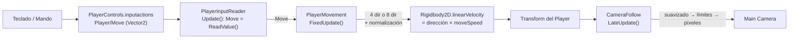
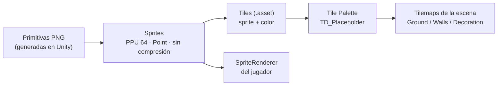

# TD_Game — Arquitectura actual

> Estado al **3 de noviembre de 2026** (tareas del calendario hasta el 10 de noviembre).
> Documento vivo: se actualiza cuando cambia la estructura. Para usar y modificar el proyecto, ver [TD_Game_GUIA.md](TD_Game_GUIA.md).
> Reglas y decisiones técnicas: [CLAUDE.md](CLAUDE.md) · Plan: [DEVELOPMENT_CALENDAR.md](DEVELOPMENT_CALENDAR.md)

---

## 1. Visión general

TD_Game es un juego **top-down 2D** en Unity 6 (6000.5.9f1, Built-in Render Pipeline), construido desde cero dentro del mismo proyecto que el juego anterior (Mictlán v5), pero **aislado** de él:

| | TD_Game (nuevo) | Mictlán v5 (anterior, solo referencia) |
|---|---|---|
| Carpeta | `Assets/TD_Game/` | `Assets/Scripts`, `Assets/Resources`, `Assets/Scenes`… |
| Namespace C# | `TD_Game` | ninguno (global) |
| Mundo | Tilemaps pintados en el editor | generado en código desde `level.json` |
| Input | asset `PlayerControls.inputactions` | acciones creadas en código |
| Escenas | `TD_Game/Scenes/Testing/TestLevel.unity` | `Boot`, `MainMenu`, `Game` |

Ningún script de TD_Game usa clases del juego anterior, y al revés.

---

## 2. Estructura de carpetas

```
Assets/TD_Game/
├── Art/
│   ├── Characters/Placeholder/
│   │   └── CharacterOutline_40x56.png      primitiva del jugador (pivote en los pies)
│   └── Tilesets/
│       ├── Placeholder/
│       │   ├── Textures/                   primitivas: Square_64, SquareOutline_64, TallOutline_64x128
│       │   └── Tiles/                      Ground_Grass, Ground_Dirt, Water, Wall_Stone, Deco_Pillar_Tall
│       └── Palettes/
│           └── TD_Placeholder.prefab       Tile Palette (Rectangle, celda 1 × 1)
├── Scenes/Testing/
│   └── TestLevel.unity                     escena de pruebas
├── Scripts/
│   ├── Camera/CameraFollow.cs
│   └── Player/
│       ├── PlayerInputReader.cs
│       └── PlayerMovement.cs
└── Settings/Input/
    └── PlayerControls.inputactions
```

Las carpetas se crean **cuando se necesitan** (CLAUDE.md §7). Las previstas para las próximas etapas son `Animations/`, `Prefabs/` y `Scripts/Interactions/`.

---

## 3. Escena `TestLevel`

```
TestLevel
├── Main Camera      Camera (ortográfica, size 4.21875) · AudioListener · CameraFollow
├── Grid             Grid (Rectangle, celda 1 × 1)
│   ├── Ground       Tilemap · TilemapRenderer (orden -10, Chunk)
│   ├── Walls        Tilemap · TilemapRenderer (orden 0, Individual)
│   └── Decoration   Tilemap · TilemapRenderer (orden 0, Individual)
└── Player           Rigidbody2D · CapsuleCollider2D · PlayerInputReader · PlayerMovement   (tag: Player)
    └── Visual       SpriteRenderer (orden 0, Sort Point = Pivot)
```

**Mapa de prueba:** 30×20 celdas (x de -15 a 14, y de -10 a 9).

```
 x: -15            -1  0    5  6        14
    ┌────────────────┬──────┬──────────┐  y = 9
    │  SALA IZQUIERDA│      │  SALA    │
    │  estanque 3×2  │ ROCA │  DERECHA │
    │  pilares       │      │  pilares │
    ├────────────────┴──────┴──────────┤  y = 0
    │ ======== PASILLO DE TIERRA ===== │  y = -1
    ├────────────────┬──────┬──────────┤
    │  pilares       │ ROCA │ estanque │
    │                │      │ 2×2      │
    └────────────────┴──────┴──────────┘  y = -10
  Jugador inicial: (-11,5, -0,5), sobre el pasillo de la sala izquierda.
```

---

## 4. Flujo de datos del jugador



| Paso | Componente | Cuándo | Qué hace |
|---|---|---|---|
| 1 | `PlayerInputReader` | `Update` | Lee `Player/Move` y guarda el resultado en la propiedad `Move` (cada eje entre -1 y 1). No sabe nada de física. |
| 2 | `PlayerMovement` | `FixedUpdate` | Convierte `Move` en dirección: en modo 4 direcciones gana el eje dominante, y solo se normaliza si la longitud supera 1. Fija la velocidad del `Rigidbody2D`. Expone `MoveDirection`, `Velocity` y `MoveSpeed`. |
| 3 | `Rigidbody2D` | física | Mueve el cuerpo. La interpolación suaviza el dibujo entre pasos físicos. |
| 4 | `CameraFollow` | `LateUpdate` | Persigue al objetivo con `SmoothDamp`, lo limita a los bordes del Tilemap `Ground` y redondea a 1/64 de unidad (1 píxel de arte). |

**Principios:**
- **La entrada está separada de la lógica.** Se puede cambiar el origen del input (IA, repeticiones, otro esquema) sin tocar el movimiento.
- **El movimiento no conoce la animación ni la cámara.** Los sistemas futuros leerán sus propiedades públicas (`MoveDirection`, `Velocity`) sin crear dependencias hacia atrás.
- **Los valores ajustables son campos serializados**, editables en el Inspector; no hay números mágicos en el código.

---

## 5. Pipeline de arte (placeholder)



- **Escala:** 64 px = 1 unidad = 1 celda.
- **Un mismo sprite blanco sirve para varios tiles**: el color lo pone el `Tile` (`Tile.color`).
- **Pivotes:**
  - tiles: centro;
  - objeto alto de 64×128: (0.5, 0.25), para que su base ocupe su celda;
  - personajes: pies (bottom-center).
- Cuando llegue el arte del equipo, se sustituye cada PNG o se reasigna el sprite de cada Tile. Las escenas no cambian.

---

## 6. Orden de dibujo (profundidad)

| Ajuste | Valor | Dónde |
|---|---|---|
| Transparency Sort Mode | Custom Axis (0, 1, 0) | *Project Settings > Graphics* |
| `Ground` | orden -10, modo Chunk | siempre detrás |
| `Walls`, `Decoration` | orden 0, modo **Individual** | cada tile se ordena por su altura en pantalla |
| Jugador (`Visual`) | orden 0, **Sort Point = Pivot** (pies) | se ordena con los tiles por la Y de los pies |

Resultado: entre objetos con el mismo orden, **el que tiene los pies más abajo en pantalla se dibuja delante**. Por eso el jugador pasa por delante o por detrás de los pilares según su posición. Las *Sorting Layers* y los *Sorting Groups* llegan el 16 nov.

---

## 7. Configuración del proyecto relevante

| Ajuste | Valor |
|---|---|
| Render pipeline | Built-in |
| Active Input Handling | Input System Package (New) |
| Física 2D | gravedad (0, 0) |
| Paquetes añadidos | `com.unity.2d.tilemap` 1.0.0 (Tile Palette), `com.unity.2d.sprite` 1.0.0 (Sprite Editor) |
| Pixel Perfect Camera | no instalada (pendiente de decisión) |

---

## 8. Lo que aún no existe (según calendario)

| Sistema | Fecha | Encaje previsto |
|---|---|---|
| 8 direcciones + `PlayerDirection` (última dirección válida) | 11 nov | `allowDiagonals` = true; `PlayerDirection` lee `PlayerMovement.MoveDirection` |
| Colisiones del mundo | 12 nov | `TilemapCollider2D` + `CompositeCollider2D` en `Walls` (y en el agua) |
| Animaciones | 13 nov | `PlayerAnimation` lee `PlayerDirection` y `Velocity` y alimenta un Animator con Blend Trees |
| Prefab del jugador | 14 nov | `Prefabs/Characters/Player.prefab` |
| Sorting Layers / Groups | 16 nov | capas `Ground`, `World`, `Overhead`, `UI` |
| Prefabs de entorno e interacciones | 17–18 nov | `IInteractable` + acción `Interact` |
