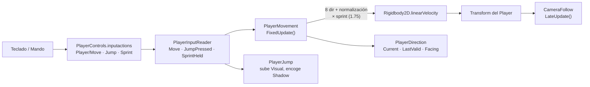
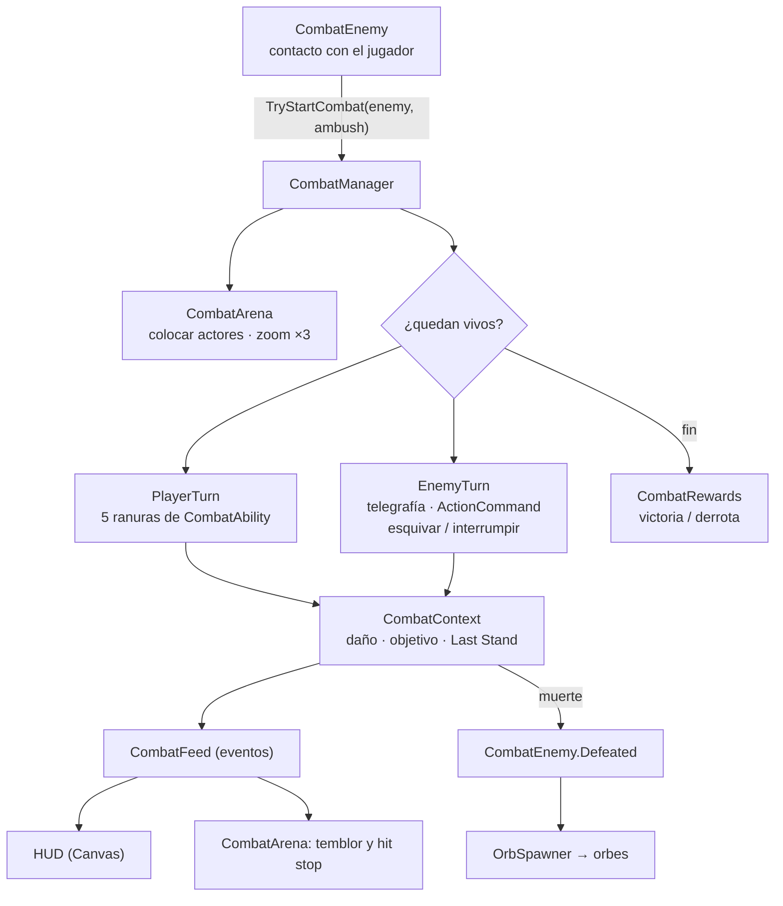
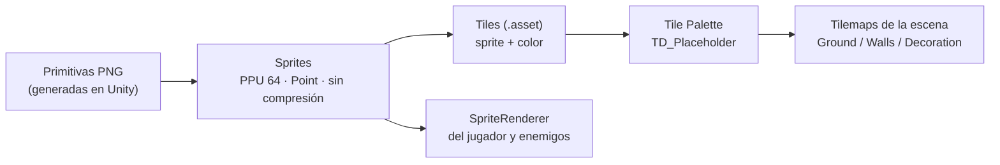

# TD_Game — Arquitectura actual

> Estado al **13 de noviembre de 2026**.
> Documento vivo: se actualiza cuando cambia la estructura. Para usar y modificar el proyecto, ver [TD_Game_GUIA.md](TD_Game_GUIA.md).
> Reglas y decisiones técnicas: [CLAUDE.md](CLAUDE.md) · Plan: [DEVELOPMENT_CALENDAR.md](DEVELOPMENT_CALENDAR.md) · Cambios: [DEVELOPMENT_LOG.md](DEVELOPMENT_LOG.md)

---

## 1. Visión general

TD_Game es un juego **top-down 2D** en Unity 6 (6000.5.9f1, Built-in Render Pipeline). Se construye desde cero dentro del mismo proyecto que el juego anterior (Mictlán v5), pero **aislado** de él:

| | TD_Game (nuevo) | Mictlán v5 (anterior, solo referencia) |
|---|---|---|
| Carpeta | `Assets/TD_Game/` | `Assets/Scripts`, `Assets/Resources`, `Assets/Scenes`… |
| Namespace C# | `TD_Game` | ninguno (global) |
| Mundo | Tilemaps pintados en el editor | generado en código desde `level.json` |
| Input | asset `PlayerControls.inputactions` | acciones creadas en código |
| Combate | componentes cortos + habilidades como ScriptableObjects | un `BattleManager` de 679 líneas |
| UI | Canvas en la escena (editable) | generada en código |
| Escenas | `TD_Game/Scenes/Testing/TestLevel.unity` | `Boot`, `MainMenu`, `Game` |

Ningún script de TD_Game usa clases del juego anterior, y al revés. Algunas clases repiten nombre (`GameState`, `Health`, `EnemyData`), pero no chocan porque las de TD_Game viven en el namespace `TD_Game`.

---

## 2. Estructura de carpetas

```
Assets/TD_Game/
├── Art/                                    primitivas placeholder (personaje, tiles, paleta)
├── Prefabs/Interactables/
│   └── Orb.prefab                          orbe que sueltan los enemigos (SoulOrb)
├── Scenes/Testing/
│   └── TestLevel.unity                     escena de pruebas
├── ScriptableObjects/
│   ├── Characters/PlayerStats_Tlahuelli    valores base del jugador
│   ├── Abilities/                          Ability_Attack, _MictlanFury, _SeismicJump, _Potion, _TonalliBurst
│   └── Enemies/                            EnemyData_TestHound, _TestBrute, _TestWitch (provisionales)
├── Scripts/
│   ├── Camera/CameraFollow.cs              seguimiento, límites, píxeles y temblor
│   ├── Managers/GameState.cs               modo global: Exploration, Combat, Paused, Cutscene
│   ├── Player/                             InputReader, Movement (caminar y sprint), Direction (8 dir.),
│   │                                       Jump, Combatant, Progression
│   ├── Combat/                             CombatManager, Arena, PlayerTurn, EnemyTurn, Rewards, Context,
│   │   │                                   Input, Feed, Motion, ActionCommand, Health
│   │   ├── Abilities/                      CombatAbility (base) y las 5 habilidades
│   │   └── Data/                           PlayerStats, EnemyData, EnemyAttack
│   ├── Enemies/CombatEnemy.cs              lo que necesita un enemigo para pelear
│   ├── Interactions/                       SoulOrb, OrbSpawner
│   ├── UI/                                 HUD: UIBar, PlayerStatusPanel, ActionButton, CombatActionMenu,
│   │                                       EnemyHealthBars, CombatMessages, CombatHUD
│   └── Editor/CombatHUDBuilder.cs          menú TD_Game > Build Combat HUD
└── Settings/Input/
    └── PlayerControls.inputactions         mapas Player y Combat
```

Las carpetas se crean **cuando se necesitan** (CLAUDE.md §7). Las siguientes previstas son `Animations/` y `Prefabs/Characters/`.

---

## 3. Escena `TestLevel`

```
TestLevel
├── Main Camera      Camera (ortográfica, size 4.21875) · AudioListener · CameraFollow
├── Grid             Grid (Rectangle, celda 1 × 1)
│   ├── Ground       Tilemap · TilemapRenderer (orden -10, Chunk)
│   ├── Walls        Tilemap · TilemapRenderer (orden 0, Individual)
│   └── Decoration   Tilemap · TilemapRenderer (orden 0, Individual)
├── Player           Rigidbody2D · CapsuleCollider2D · PlayerInputReader · PlayerMovement · PlayerDirection
│   │                PlayerJump · Health · PlayerProgression · PlayerCombatant
│   ├── Visual       SpriteRenderer (orden 0, Sort Point = Pivot)  ← sube al saltar
│   └── Shadow       SpriteRenderer (orden -1)                     ← se queda en el suelo
├── Combat           CombatInput · CombatArena · PlayerTurn · EnemyTurn · CombatRewards · CombatManager · OrbSpawner
├── Enemy_TestHound  Rigidbody2D (Kinematic) · BoxCollider2D · Health · CombatEnemy   (sala izquierda)
├── Enemy_TestBrute  ídem                                                              (sala derecha)
├── Enemy_TestWitch  ídem                                                              (sala derecha)
├── CombatHUD        Canvas (Screen Space Overlay, 960×540 de referencia) · CombatHUD
│   ├── PlayerStatus     PlayerStatusPanel (siempre visible)
│   ├── CombatGroup      CanvasGroup (solo en combate)
│   │   ├── EnemyBars    EnemyHealthBars
│   │   ├── TurnOrder    TurnOrderBar (quién actúa)
│   │   ├── CommandMenu  CombatActionMenu · 5 filas ActionButton + End Turn (lista diagonal)
│   │   └── EnemyTurnBar barra DEFEND (turno enemigo)
│   └── Messages         CombatMessages (banner, turno, avisos, combo, números)
└── EventSystem      InputSystemUIInputModule
```

**Mapa de prueba:** 30×20 celdas (x de -15 a 14, y de -10 a 9).

```
 x: -15            -1  0    5  6        14
    ┌────────────────┬──────┬──────────┐  y = 9
    │  SALA IZQUIERDA│      │  SALA    │
    │  estanque 3×2  │ ROCA │  DERECHA │
    │  Hound         │      │  Brute + │
    │  pilares       │      │  Witch   │
    ├────────────────┴──────┴──────────┤  y = 0
    │ ======== PASILLO DE TIERRA ===== │  y = -1
    ├────────────────┬──────┬──────────┤
    │  pilares       │ ROCA │ estanque │
    │                │      │ 2×2      │
    └────────────────┴──────┴──────────┘  y = -10
  Jugador inicial: (-11,5, -0,5), sobre el pasillo de la sala izquierda.
```

---

## 4. Flujo del jugador en exploración



| Paso | Componente | Qué hace |
|---|---|---|
| 1 | `PlayerInputReader` | Lee `Move`, `Jump` (pulsación) y `Sprint` (mantener). No sabe nada de física. |
| 2 | `PlayerMovement` | Solo en `GameMode.Exploration`. Usa 8 direcciones y normaliza la diagonal. Sprint ×1.75 con transición suave. Expone `MoveDirection`, `Velocity`, `IsSprinting` y `CurrentSpeed`. |
| 3 | `PlayerDirection` | Dirección actual, última válida y `Facing` (`Direction8`); sirve para animaciones y para orientarse en combate. |
| 4 | `PlayerJump` | Salto visual. En el aire ignora la colisión con enemigos; si cae sobre uno empieza una **emboscada**. |
| 5 | `CameraFollow` | `SmoothDamp`, límites del Tilemap `Ground`, redondeo a 1/64 de unidad y temblor (`Shake`). |

**Principios:**
- La entrada está separada de la lógica.
- El movimiento no conoce la animación ni la cámara: los demás leen sus propiedades públicas.
- Los valores ajustables son campos serializados o ScriptableObjects, no números mágicos.

---

## 5. Combate por turnos



| Pieza | Responsabilidad |
|---|---|
| `CombatManager` | Flujo de la batalla. Une a los enemigos a 4 tiles o menos (máximo 3). Eventos `CombatStarted`, `CombatWon` y `CombatLost`. |
| `CombatArena` | Coloca al jugador a la izquierda y a los enemigos a la derecha sobre el mismo mapa; zoom de 4.21875 a 2.8125. Temblor y *hit stop*. |
| `PlayerTurn` | Ranuras attack, skill1, skill2, potion y ultimate (teclas 1–5). Varias acciones por turno mientras haya estamina. |
| `EnemyTurn` | Telegrafía en rojo; ventana de esquivar (Dodge) o interrumpir (Interrupt); PERFECT: +estamina, +Tonalli y contraataque; efecto único del ataque. |
| `ActionCommand` | Pulsación con *timing* y bloqueo si pulsas antes de tiempo. Se usa para el crítico (NOW!) y los contraataques (DODGE!/INTERRUPT!). |
| `CombatAbility` | Base de las habilidades (ScriptableObject): coste, desbloqueo, una vez por combate, `Execute`. |
| `CombatContext` | Datos de la batalla en curso y aplicación del daño con su feedback. |
| `CombatRewards` | Victoria: crecimiento, desbloqueos, poción y checkpoint. Derrota: reintento desde el checkpoint. |
| `CombatFeed` | Eventos estáticos hacia la UI y la cámara. **La lógica nunca llama a la UI directamente.** |

**Recursos del jugador** (`PlayerCombatant` y `PlayerStats`):

| Recurso | Se gana con | Se gasta en |
|---|---|---|
| Vida | orbes de jade, pociones, Fury | daño enemigo |
| Estamina | se recupera un 60 % al inicio de cada turno; PERFECT | cada acción |
| Tonalli (concentración) | orbes azules, PERFECT, críticos | Tonalli Burst (barra llena) |
| Carga del Macuahuitl | orbes dorados (almas) | — (aumenta el daño hasta +100 %) |

**Progresión** (`PlayerProgression`): habilidades desbloqueadas (`unlocksOnDefeat` y Last Stand), vida y estamina máximas extra, victorias y checkpoint.

---

## 6. Orbes

`CombatEnemy.Defeated` → `OrbSpawner` crea orbes (`Orb.prefab`) según `EnemyData.soulsOnDefeat`, `healthOnDefeat` y `concentrationOnDefeat`, con un valor fijo por orbe. Cada `SoulOrb`:
1. sale en arco desde el enemigo;
2. flota en el suelo;
3. solo en **exploración**, si el jugador está cerca, se acerca a él (imán);
4. se recoge al tocarlo (`OnTriggerEnter2D`/`Stay2D`) y lanza `OrbSpawner.Collected` para la UI.

---

## 7. Pipeline de arte (placeholder)



- **Escala:** 64 px = 1 unidad = 1 celda.
- **Un mismo sprite blanco sirve para varios tiles**: el color lo pone el `Tile` (`Tile.color`).
- **Pivotes:**
  - tiles: centro;
  - objeto alto de 64×128: (0.5, 0.25), para que su base ocupe su celda;
  - personajes: pies (bottom-center).
- Los movimientos de combate (`CombatMotion`) y el salto son provisionales hasta tener animaciones de Aseprite.

---

## 8. Orden de dibujo (profundidad)

| Ajuste | Valor | Dónde |
|---|---|---|
| Transparency Sort Mode | Custom Axis (0, 1, 0) | *Project Settings > Graphics* |
| `Ground` | orden -10, modo Chunk | siempre detrás |
| Sombra del jugador | orden -1 | sobre el suelo, debajo de todo lo demás |
| `Walls`, `Decoration` | orden 0, modo **Individual** | cada tile se ordena por su altura en pantalla |
| Jugador y enemigos (`Visual`) | orden 0, **Sort Point = Pivot** (pies) | se ordenan con los tiles por la Y de los pies |
| Orbes | orden 5 | siempre visibles |
| HUD | Canvas Overlay, orden 10 | encima de todo |

---

## 9. Configuración del proyecto relevante

| Ajuste | Valor |
|---|---|
| Render pipeline | Built-in |
| Active Input Handling | Input System Package (New) |
| Física 2D | gravedad (0, 0) |
| Modo del editor | 2D |
| Paquetes añadidos | `com.unity.2d.tilemap`, `com.unity.2d.sprite`, `com.coplaydev.unity-mcp` (puente con Claude) |
| Pixel Perfect Camera | no instalada (pendiente de decisión) |

---

## 10. Lo que aún no existe (según calendario)

| Sistema | Encaje previsto |
|---|---|
| Colisiones del mundo (hoy se atraviesan muros y agua) | `TilemapCollider2D` + `CompositeCollider2D` en `Walls` y en el agua |
| IA de exploración de los enemigos | componente aparte que llama `CombatManager.Instance.TryStartCombat(enemy)` y respeta `GameState.IsExploring` |
| Enemigos y jefe reales | `EnemyData` nuevos con sus ataques y efectos; el jefe necesita fases |
| Animaciones | `PlayerAnimation` lee `PlayerDirection`, `Velocity` e `IsSprinting` y alimenta un Animator |
| Prefabs del jugador y enemigos | `Prefabs/Characters/` |
| Sorting Layers / Groups | capas `Ground`, `World`, `Overhead`, `UI` |
| Menús, pausa, guardado y audio | según el calendario (16–18 nov) |
