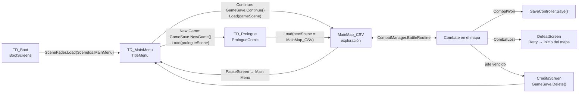
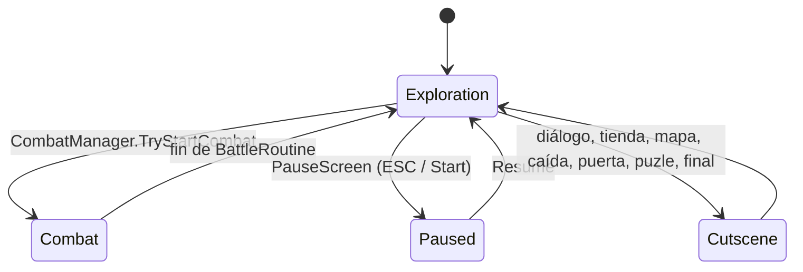
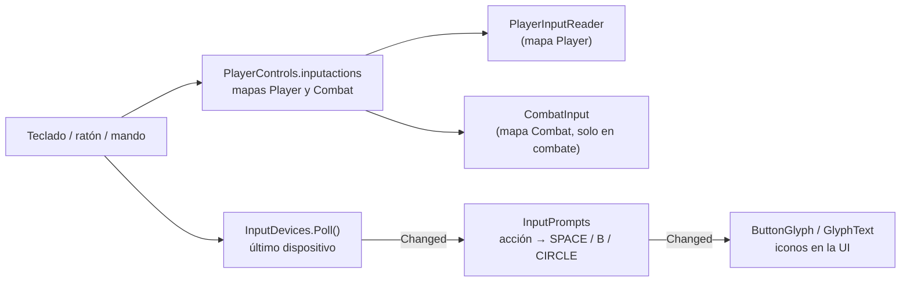
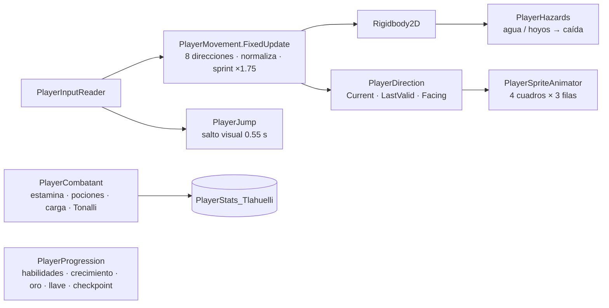
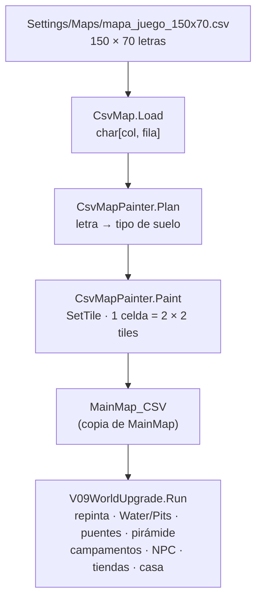
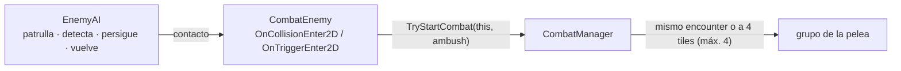
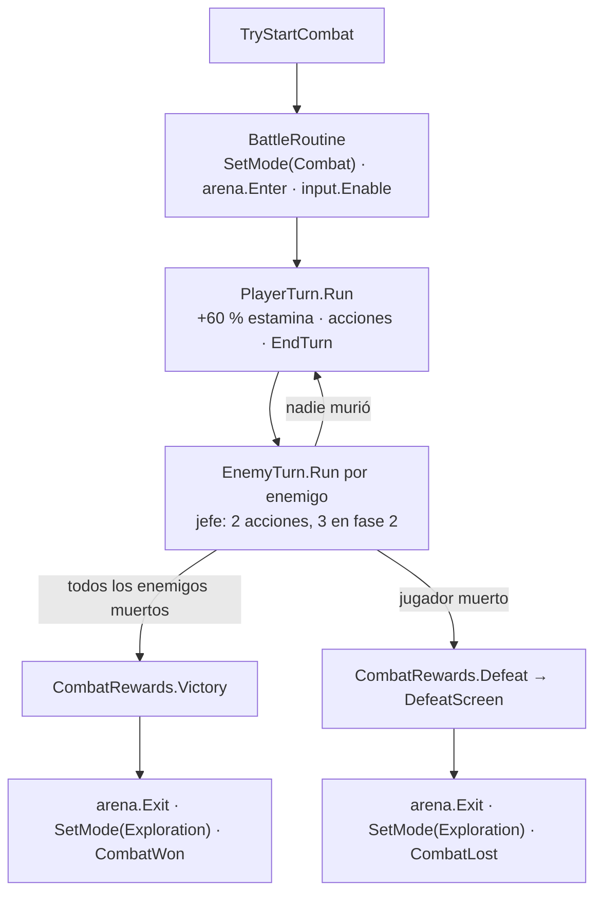
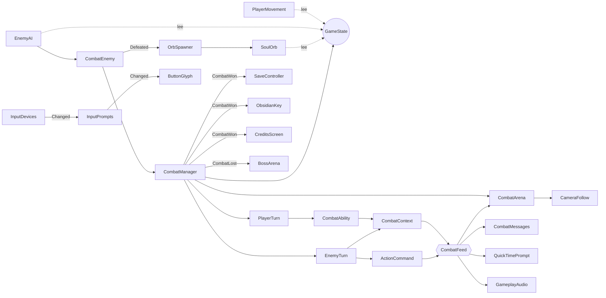

# Mictlán — Arquitectura

> **Fecha:** 26 de noviembre de 2026 · **Rama:** `v0.6` (último commit `0d35fc4`; `bundleVersion` 0.9.0) · **Motor:** Unity 6000.5.9f1
> Verificado contra el código de `Assets/`, las escenas abiertas por MCP y la configuración del proyecto.
> Cómo cambiar cada cosa: [TD_Game_GUIA.md](TD_Game_GUIA.md) · Reglas del proyecto: [CLAUDE.md](CLAUDE.md) · Historial: [DEVELOPMENT_LOG.md](DEVELOPMENT_LOG.md)

---

## Índice
1. [Visión general y stack técnico](#1-visión-general-y-stack-técnico)
2. [Estructura de carpetas](#2-estructura-de-carpetas)
3. [Flujo del juego y de escenas](#3-flujo-del-juego-y-de-escenas)
4. [Desglose por escena](#4-desglose-por-escena)
5. [Arquitectura por sistemas](#5-arquitectura-por-sistemas)
6. [Datos (ScriptableObjects)](#6-datos-scriptableobjects)
7. [Convenciones y principios de diseño](#7-convenciones-y-principios-de-diseño)
8. [Orden de dibujo y pipeline de arte](#8-orden-de-dibujo-y-pipeline-de-arte)
9. [Dependencias entre sistemas](#9-dependencias-entre-sistemas)
10. [Estado actual, pendientes y obsoletos](#10-estado-actual-pendientes-y-obsoletos)

---

## 1. Visión general y stack técnico

**Mictlán** es un juego 2D top-down de pixel art con **combate por turnos en el mismo mapa**. Tlahuelli recorre el Mictlán (bosques, valles, desierto y una pirámide), pelea contra los servidores de los dioses, consigue la llave de obsidiana y se enfrenta a **Quetzalcóatl**. Todo el juego vive en `Assets/TD_Game/` con el namespace C# `TD_Game` (las herramientas del editor usan `TD_Game.EditorTools`).

| Aspecto | Valor verificado |
|---|---|
| Producto / empresa | `Mictlan` / `Micta Forge` (*Player Settings*) |
| Versión | `bundleVersion` **0.9.0** (el menú muestra v0.9) |
| Render pipeline | **Built-in** (sin URP) · espacio de color **Linear** |
| Input | **Input System Package** (`activeInputHandler = 1`), asset `Settings/Input/PlayerControls.inputactions` |
| Física 2D | gravedad **(0, 0)** |
| Capas (Layers) | 0 Default · 1 TransparentFX · 2 Ignore Raycast · 4 Water · 5 UI · **8 Player · 9 Hazard · 10 LowObstacle** |
| Colisiones entre capas | `Player` **ignora** `Hazard`; `Player` choca con `LowObstacle`; `Default` choca con `Hazard` |
| Sorting Layers | solo **Default**: la profundidad se resuelve con *Order in Layer* y el eje Y |
| Orden transparente | *Transparency Sort Mode* = **Custom Axis (0, 1, 0)** |
| Resolución por defecto | 1280×720, `FullScreenWindow` · plataforma **StandaloneWindows64** |
| Cámara del mapa | ortográfica, `size` **6.75** (exploración) y **4.219** en combate, fondo negro |

**Paquetes** (`Packages/manifest.json`, además de los módulos de Unity):

| Paquete | Para qué |
|---|---|
| `com.unity.inputsystem` 1.20.0 | entrada de teclado, ratón y mando |
| `com.unity.2d.tilemap` 1.0.0 | Grid, Tilemap y Tile Palette |
| `com.unity.2d.sprite` 1.0.0 | Sprite Editor |
| `com.unity.ugui` 2.5.0 | interfaz (Canvas, `Text`, `Image`) |
| `com.coplaydev.unity-mcp` (rama `#main`) | puente MCP con Claude (solo en el editor) |
| `com.unity.ide.rider` / `com.unity.ide.visualstudio` | integración con el IDE |

No se usa TextMesh Pro: los textos son `UnityEngine.UI.Text` con la fuente **Pirata One** (`Art/Fonts`) o `LegacyRuntime`.

---

## 2. Estructura de carpetas

```
Assets/TD_Game/
├── Art/
│   ├── Characters/        sprites de Tlahuelli, enemigos y jefe (incluye arte reutilizado de Mictlán v5)
│   ├── Comic/             viñetas de la historieta
│   ├── Effects/           oscuridad, brillos, sangre, llave, antorcha (generados por ArtGenerator)
│   ├── Environment/       arte del equipo (árboles, rocas, niebla) y recortes de v0.9
│   ├── Fonts/             PirataOne-Regular + licencia OFL
│   ├── Props/             objetos del mapa (tienda, pirámide, braseros, casa, NPC…)
│   ├── Tilesets/          Mictlan/ (tiles generados), Vely/ (pasto y árboles de Vely), Placeholder/, Palettes/
│   └── UI/                marcos aztecas, grecas, viñeta de combate
├── Audio/                 AudioLibrary.asset · Music/ · SFX/ · Voice/ (voces del comerciante)
├── Materials/             SpriteSkin.mat (recolor de skins)
├── Prefabs/
│   ├── Characters/        Player, Enemy_Wolf, Enemy_Witch, Enemy_Giant, Boss_Quetzalcoatl
│   └── Interactables/     Orb.prefab
├── Scenes/
│   ├── MainMenu/          TD_Boot, TD_MainMenu, TD_Prologue
│   ├── Levels/            MainMap_CSV (el juego) · MainMap (mapa anterior)
│   └── Testing/           TestLevel
├── ScriptableObjects/
│   ├── Abilities/         6 habilidades
│   ├── Characters/        PlayerStats_Tlahuelli
│   ├── Enemies/           8 EnemyData (5 del juego + 3 de prueba)
│   └── Items/             SkinCatalog
├── Scripts/               (ver tabla siguiente)
├── Settings/
│   ├── Input/             PlayerControls.inputactions
│   └── Maps/              mapa_juego_150x70.csv
└── Shaders/               SpriteSkin.shader
```

| Carpeta de `Scripts/` | Scripts | Contenido |
|---|---|---|
| `Audio/` | 4 | `GameAudio`, `AudioLibrary`, `GameplayAudio`, `AmbientSoundscape` |
| `Camera/` | 1 | `CameraFollow` |
| `Combat/` | 12 + `Abilities/` 7 + `Data/` 3 + `Fx/` 7 | combate por turnos, habilidades, datos y efectos procedurales |
| `Enemies/` | 2 | `CombatEnemy`, `EnemyAI` |
| `Interactions/` | 10 | tienda, NPC, llave, puerta, cofres, orbes, avisos |
| `Managers/` | 4 | `GameState`, `GameSave`, `SaveController`, `SceneFader` |
| `Player/` | 11 | input, movimiento, salto, caídas, progresión, skins, animación |
| `UI/` | 33 | HUD, menús, historieta, iconos de botones, mapa, diálogos |
| `World/` | 10 | jefe, puzles, misión de las brujas, zonas, puertas |
| `Editor/` | 17 + `V09/` 13 | herramientas que **construyen** escenas y arte; no entran en la build |
| `Testing/` | 2 | self-test de v0.9 (solo editor) |

En total: **136 scripts** (106 de juego y 30 de editor). Los archivos obsoletos están en la [sección 10](#10-estado-actual-pendientes-y-obsoletos).

---

## 3. Flujo del juego y de escenas

**Escenas en Build Settings** (en este orden, todas activas): `TD_Boot` → `TD_MainMenu` → `TD_Prologue` → `MainMap` → `MainMap_CSV` → `TestLevel`. El juego solo recorre las cuatro marcadas abajo; `MainMap` y `TestLevel` entran en la build pero ningún menú las carga.



| Transición | Quién la dispara | Método |
|---|---|---|
| Boot → menú | `BootScreens` (logo → clasificación → descripción) | `SceneFader.Load(nextScene)` |
| Menú → historieta | `TitleMenu.OnStartGame()` | `SceneFader.Load(prologueScene)` (o `gameScene` si no existe) |
| Menú → mapa (Continue) | `TitleMenu.OnContinue()` | `GameSave.Continue()` + `SceneFader.Load(...)` |
| Historieta → mapa | `PrologueComic.Play()` | `SceneFader.Load(nextScene)`; `nextScene = SceneIds.MainMap = "MainMap_CSV"` |
| Pausa → menú | `PauseScreen` | `SceneFader.Load("TD_MainMenu")` |
| Derrota → menú | `DefeatScreen` (opción Main Menu) | `SceneFader.Load(mainMenuScene)` |
| Final → menú | `CreditsScreen` | borra la partida y vuelve al menú |

**Qué persiste entre escenas**

| Qué | Cómo |
|---|---|
| Música y efectos | `GameAudio`: el primero se queda con `DontDestroyOnLoad`; cada escena trae uno con su `sceneMusic` |
| Fundido de escena | `SceneFader` crea su propio objeto `DontDestroyOnLoad` |
| Último dispositivo usado | `InputDevices` crea un objeto oculto `DontDestroyOnLoad` (`[RuntimeInitializeOnLoadMethod]`) |
| Opciones | `PlayerPrefs`: volúmenes, pantalla completa, gore, `td_button_icons` (modo de iconos) |
| Partida | archivo JSON `td_game_save.json` en `Application.persistentDataPath` (`GameSave`) |
| «Continuar» | bandera estática `GameSave.ContinueRequested`, que lee `SaveController.Start()` |
| Consejos ya vistos | `ContextTutorial` (estático, se guarda en la partida) |

---

## 4. Desglose por escena

### `TD_Boot`, `TD_MainMenu` y `TD_Prologue`
Escenas mínimas: la interfaz se construye **en código** al iniciar (`MenuWidgets`).

| Escena | Objetos raíz |
|---|---|
| `TD_Boot` | `Main Camera` · `BootScreens` · `GameAudio` |
| `TD_MainMenu` | `Main Camera` · `TitleMenu` · `GameAudio` |
| `TD_Prologue` | `Main Camera` · `PrologueComic` · `GameAudio` |

### `MainMap_CSV` (el juego)
Jerarquía real (objetos raíz y componentes clave):

```
Main Camera            Camera · AudioListener · CameraFollow
└── Darkness           SpriteRenderer (orden 500, pegada a la cámara)
Grid                   Grid
├── Ground             Tilemap (300×140) · orden -10 · Chunk
├── Walls              Tilemap · TilemapCollider2D · orden 0 · Individual
├── Decoration         Tilemap (vacío) · orden 0
├── Water              Tilemap · TilemapCollider2D · capa Hazard · orden -9
└── Pits               Tilemap · TilemapCollider2D · capa Hazard · orden -9
Player                 Rigidbody2D · CapsuleCollider2D · PlayerInputReader · PlayerMovement · PlayerDirection
                       Health · PlayerProgression · PlayerCombatant · PlayerJump · MacuahuitlRig
                       PlayerSpriteAnimator · PlayerHazards · PlayerSkin · SortingGroup   (capa Player)
├── Visual             SpriteRenderer  → Torch, Macuahuitl (MacuahuitlSwing)
└── Shadow             SpriteRenderer
Combat                 CombatInput · CombatArena · PlayerTurn · EnemyTurn · CombatRewards · CombatManager · OrbSpawner
SaveController · GameAudio (+GameplayAudio) · PauseScreen · EventSystem · ClickToTarget · GoreEffects
Enemies                40 enemigos: 18 Wolf, 15 Witch, 7 Giant (Rigidbody2D · BoxCollider2D · Health · CombatEnemy · EnemyAI)
BossZone               Boss_Quetzalcoatl · BossArena (trigger) · BossGate · BossGate_2
ObsidianKey · ObsidianDoor · ObsidianDoor_2   (KeyDoor; una puerta por entrada de la pirámide)
Chests                 Chest_1 … Chest_5 (LootChest)
Merchant (Shop) + 3 × V09_Merchant (…)        MerchantShop en cada TalkArea
Puzzle (Four Fires)    BrazierPuzzle · 4 braseros (PuzzleBrazier) · Treasure (TreasureChest) · Stela
House of the Sword (H) · Territories (4 ZoneArea) · TempleDecor_CSV · MapBorder (4 BoxCollider2D)
GameFlowUI             Canvas (orden 20): TutorialHint (ContextTutorial) · GameOverScreen (DefeatScreen) · CreditsScreen
MapUI                  Canvas (orden 5) · InteractPrompt: Minimap · Gold · ShopPrompt · ZoneTitle · QuickTimePrompt · EnemiesLeft
CombatHUD              Canvas (orden 10) · CombatHUD: PlayerStatus · CombatGroup (CombatVignette, EnemyBars,
                       TurnOrder, CommandMenu, EnemyTurnBar) · Messages
V09_*                  contenido de v0.9: Ambience, Dialogue (DialogueBox), WorldMap (WorldMapScreen), Pyramid,
                       PyramidDecor, Landmarks, Nature, Obstacles, Mist, Villagers (NPC con DialogueNPC), WitchHouse,
                       WitchHouseInside (PaintingPuzzle · WitchHouseQuest), WitchMist, Interiors (Grid: WitchFloor, WitchWalls)
```

- `Player` empieza en **(27, 127)**, la celda `S` del CSV.
- La casa de las brujas es un **cuarto aparte** (`V09_Interiors`) al que se llega con `HouseDoor`. Dentro están las 4 brujas `Cihuateotl` de la misión (`Witches`).

### `MainMap` y `TestLevel`
- `MainMap`: el mapa anterior de Alex (88×40 tiles), con los mismos sistemas que `MainMap_CSV` pero sin v0.9. Es la base que copia `CsvMapBuilder`.
- `TestLevel`: escena de pruebas técnicas con `Enemy_TestHound`, `Enemy_TestBrute` y `Enemy_TestWitch`.

---

## 5. Arquitectura por sistemas

### 5.1 Estado global — `Managers/GameState.cs`



- `enum GameMode { Exploration, Combat, Paused, Cutscene }`.
- `GameState.SetMode(modo)` cambia el modo y lanza el evento `ModeChanged`.
- `GameState.IsExploring` es la condición que consultan el movimiento, el salto, la IA, los orbes, las interacciones y los menús.
- Pasan a `Cutscene` (el mundo se detiene): `DialogueBox`, `MerchantShop`, `WorldMapScreen`, `PlayerHazards` (caídas), `KeyDoor`, `HouseDoor`, `PaintingPuzzle`, `WitchHouseQuest` y `CreditsScreen`.

### 5.2 Input y detección de dispositivo



| Mapa `Player` | Teclado | Mando |
|---|---|---|
| `Move` | WASD y flechas | stick izquierdo y D-pad |
| `Jump` | Espacio | A (`buttonSouth`) |
| `Sprint` (mantener) | Shift izquierdo | RT (`rightTrigger`) |

| Mapa `Combat` | Teclado | Mando |
|---|---|---|
| `Attack` | 1 | A |
| `Skill1` / `Skill2` | 2 / 3 | X / Y |
| `Potion` | 4 | D-pad ↑ |
| `Ultimate` | 5 | LB |
| `Artifact` | 6 | RT |
| `EndTurn` | Q | RB |
| `TargetPrev` / `TargetNext` | ← / → | D-pad ← / → |
| `Dodge` (esquivar **e** interrumpir) | Espacio | B |
| `Interrupt` | 1 | A — **sin uso**: `EnemyTurn` lee solo `Dodge` |

**Teclas leídas directamente en código** (no están en el `.inputactions`):

| Acción | Teclado | Mando | Dónde |
|---|---|---|---|
| Interactuar | E | Y | `InteractPrompt`, `BrazierPuzzle` |
| Mapa completo | M o Tab | View (`selectButton`) | `WorldMapScreen` |
| Pausa | ESC | Start | `MenuWidgets.PausePressed` |
| Confirmar / volver | Enter, Espacio / ESC | A / B | menús, `DefeatScreen` |
| Historieta | Espacio / Enter / clic; mantener ESC | A; mantener B | `PrologueComic` |

**Detección de dispositivo** (`UI/InputDevices.cs`):
- `Poll()` corre cada frame.
- Un mando cuenta si pulsa un botón o mueve un stick o gatillo más de **0.5**; el teclado, con cualquier tecla; el ratón, con un clic o más de 6 px de movimiento.
- `SchemeOf()` devuelve **PlayStation** si el mando es `DualShockGamepad` o su descripción dice Sony; si no, **Xbox**.

**Traducción** (`UI/InputPrompts.cs`):
- La UI pide **acciones** (`Dodge`, `Interact`, `Map`…) a una tabla interna.
- `Label()` devuelve el botón del esquema actual; `Localize()` cambia `{Acción}` por `[BOTÓN]` en un texto.
- `Mode` (Auto, Keyboard, Xbox, PlayStation) se guarda en `PlayerPrefs`.

### 5.3 Jugador



| Componente | Responsabilidad | Valores en la escena |
|---|---|---|
| `PlayerInputReader` | solo lee `Move`, `Jump` y `Sprint` | — |
| `PlayerMovement` | mueve el `Rigidbody2D` solo en Exploration | `moveSpeed` 4 · `sprintMultiplier` 1.75 · `allowDiagonals` |
| `PlayerDirection` | dirección actual, última válida y `Facing` (`Direction8`) | `initialFacing` Down |
| `PlayerJump` | el hijo `Visual` sube y la sombra se queda; en el aire ignora enemigos y la capa `LowObstacle`; si cae sobre un enemigo hay **emboscada** | `jumpHeight` 0.7 · `airTime` 0.55 · `airborneOrder` 4 |
| `PlayerHazards` | lee los Tilemaps `Water` y `Pits`; si los pies están en uno, el jugador **cae**, pierde un 8 % de vida (nunca muere) y reaparece en el último suelo firme | `damageFraction` 0.08 |
| `PlayerSpriteAnimator` | caminata con la hoja de sprites de Mictlán v5 (abajo, arriba, lado) y la antorcha | 8 fps |
| `PlayerSkin` | recolorea la ropa con el material `SpriteSkin` | `SkinCatalog` |
| `PlayerCombatant` | estamina, pociones, carga del Macuahuitl, Tonalli, combo, buffs y aturdimiento | `PlayerStats_Tlahuelli` |
| `PlayerProgression` | habilidades desbloqueadas, vida y estamina extra, victorias, oro, llave, checkpoint y `StartPoint` | — |
| `Health` | vida (compartido con los enemigos) | — |

### 5.4 Cámara — `Camera/CameraFollow.cs`
- `LateUpdate` sigue a `Target` con `SmoothDamp` (`smoothTime` 0.15), sin salir de los bordes del Tilemap `boundsTilemap` (`Ground`), y redondea a la rejilla de píxeles (`snapToPixelGrid`).
- `Follow(Transform)` cambia de objetivo con suavizado; `SnapToTarget()` salta; `Shake(amplitud, duración)` hace temblar la cámara; `ClampForView(...)` ayuda a `CombatArena` a encuadrar la pelea.
- En combate, `CombatArena` hace zoom de 6.75 a 4.219 (`combatOrthographicSize`) y lo devuelve al terminar.

### 5.5 Mundo y mapa CSV



El mapa se construye **en el editor**, en dos pasos:

1. **TD_Game > Build CSV Map (MainMap_CSV)** (`Editor/CsvMapBuilder.cs`):
   - copia `MainMap` a `MainMap_CSV`, lee el CSV y pinta el terreno;
   - coloca al jugador en `S`, los cofres en `K`, la casa en `H`, el jefe dentro de la pirámide (`M`/`I`) con una `KeyDoor` en cada entrada, la tienda y el puzle;
   - añade el borde invisible (`MapBorder`);
   - no sobrescribe: hay que borrar la escena para reconstruirla.
2. **TD_Game > v0.9 > Upgrade MainMap_CSV** (`Editor/V09/V09WorldUpgrade*.cs`):
   - repinta el suelo y convierte agua y barrancos en peligros (Tilemaps `Water` y `Pits`, capa `Hazard`);
   - añade 5 puentes y 4 cruces de piedras, troncos y obstáculos bajos (`LowObstacle`), la pirámide nueva, rocas, puntos de referencia, niebla, NPC, 3 tiendas más, la casa de las brujas y el mapa completo;
   - **coloca los enemigos en 20 campamentos fijos** (40 enemigos, lista `camps` en `V09WorldUpgrade.Content.cs`). Las letras `E` del CSV ya no se usan para poner enemigos;
   - todo cuelga de objetos `V09_*`, que se borran y se rehacen al volver a ejecutarlo.

**Leyenda del CSV** (`CsvMapPainter.Plan`):

| Letra | Se convierte en |
|---|---|
| `.` | pasto (suelo interior si está dentro de la pirámide; tierra en la cueva) |
| `C` | camino de tierra |
| `D` | arena |
| `W` | agua (puente en la fila 22, columnas 16–18) |
| `V` | barranco |
| `T` | árbol (pilar dentro de la pirámide) |
| `P` | muro de la pirámide |
| `M` | muro de la pirámide; roca en la cueva SE |
| `I` | pasillo de la pirámide |
| `S`, `E`, `K`, `H` | toman el suelo más común de sus vecinos |

**Colisiones:** sólidos con `TilemapCollider2D` en `Walls`; peligros en `Water` y `Pits` (el jugador los ignora y cae, los enemigos chocan); obstáculos bajos en `LowObstacle`; zonas interactivas como *triggers* (`OnTriggerEnter2D`).

### 5.6 Enemigos e IA en el mapa



- `EnemyAI` usa `patrolSpeed`, `chaseSpeed`, `detectRadius`, `loseRadius`, `leashRadius`, `patrolRadius` y `alertAlliesRadius` del `EnemyData`. Las paredes cortan la vista. Solo actúa si `GameState.IsExploring`.
- `CombatEnemy` guarda `data`, `strength` (1.35–2.4: más fuerte cuanto más lejos del inicio), `encounter` (id del campamento) y `optional` (enemigos de misión: no cuentan para la llave ni para «Enemies Left»). Lanza el evento estático `Defeated`.

### 5.7 Combate por turnos



| Clase | Responsabilidad |
|---|---|
| `CombatManager` | `TryStartCombat` y la corrutina `BattleRoutine`; eventos estáticos `CombatStarted`, `CombatWon`, `CombatLost`; `joinRadius` 4, `maxEnemies` 4 |
| `CombatArena` | coloca a los luchadores en un claro libre (`ClearCenter`, `clearSearchRadius` 6), los dibuja en un `SortingGroup` de orden **510** (`Raise`), zoom, temblor y *hit stop* |
| `PlayerTurn` | 6 ranuras: `attack`, `skill1`, `skill2`, `potion`, `ultimate`, `artifact`; `Request(ability)`, `RequestEndTurn()` |
| `EnemyTurn` | telegrafía, defensa de un botón, contraataque y efecto único del ataque |
| `ActionCommand` | la pulsación con *timing* (esquiva y crítico) |
| `CombatContext` | datos de la pelea, objetivo, `DamageEnemy`, `DamagePlayer` y Last Stand |
| `CombatRewards` | victoria (crecimiento, desbloqueos, checkpoint) y derrota (`DefeatScreen`, volver a `StartPoint`) |
| `CombatFeed` | eventos estáticos hacia la UI, la cámara y el audio |
| `CombatMotion` | movimientos con *game feel* (embestida, paso, reacción, muerte) |
| `ClickToTarget` | elegir objetivo con el ratón |

**Defensa de un botón** (`ActionCommand.Run` + `EnemyTurn.Hit`):
- La ventana son los últimos `counterWindow × counterWindowScale (0.75)` segundos antes del impacto (`× bossWindowScale 0.75` en el jefe); la parte final (`perfectWindowFraction` 0.5) es PERFECT.
- **Éxito:** 0 daño y contraataque automático (`Countered`): el normal pega al `goodCounterFraction` (0.6); el PERFECT pega completo y da +10 de estamina y +15 de Tonalli.
- **Pronto:** «TOO EARLY» y bloqueo de `earlyPressLockout` (0.3 s), que se multiplica **×1.5** con cada pulsación extra («LOCKED»).
- **Sin pulsar o tarde:** daño completo (`Land`), salvo un 10 % de fallo del enemigo (`missChance`).
- `CounterType`: `Dodge`, `Interrupt` (hechizos; mismo botón) o `Unavoidable`.

**Recursos**

| Recurso | En pantalla | Se gana | Se gasta |
|---|---|---|---|
| Vida | TEYOLIA · LIFE | orbes de jade, pociones, Mictlan Fury | daño enemigo, caídas (8 %) |
| Estamina | IHIYOTL · BREATH | 60 % al inicio del turno, PERFECT (+10) | cada acción (Attack 20, Potion 15…) |
| Tonalli | TONALLI · SPIRIT | orbes azules, PERFECT (+15), críticos (+8) | Tonalli Burst (barra llena) |
| Carga del Macuahuitl | «Macuahuitl %» | orbes dorados | — (daño hasta ×2) |
| Oro | GOLD | enemigos, cofres | tiendas (pociones, artefacto, skins, apuestas) |

**Daño:** `PlayerCombatant.AttackDamage(m) = round(baseDamage × DamageMultiplier × m)`, con `DamageMultiplier = (1 + carga × chargeDamageBonus) × buff × debilitado`. El ataque multiplica además por el combo (`1 + 0.15 × golpes`) y por el crítico (`× 1.6`, `× 1.84` si es perfecto). `CombatContext.DamageEnemy` aplica `DamageTakenMultiplier` (piel y guardia) y la segunda fase del jefe.

### 5.8 Orbes y recompensas
- `CombatEnemy.Defeated` → `OrbSpawner` suelta orbes según `soulsOnDefeat`, `healthOnDefeat` y `concentrationOnDefeat` (4, 5 y 5 por orbe; máximo 4 por tipo).
- `SoulOrb` (`Prefabs/Interactables/Orb.prefab`): sale en arco, flota, se acerca con un imán y **solo se recoge en exploración**. Lanza `OrbSpawner.Collected`.
- Cofres:
  - `LootChest`: oro, poción y vida, una vez;
  - `TreasureChest`: premio del puzle de los braseros.
- `ObsidianKey` aparece junto al jugador cuando no queda ningún enemigo normal vivo (comprueba en cada `CombatWon`).

### 5.9 HUD e interfaz en el mapa

| Canvas (Screen Space Overlay, referencia 960×540) | Orden | Contenido |
|---|---|---|
| `MapUI` | 5 | `Minimap`, `GoldCounter`, aviso de interacción (`InteractPrompt` sobre `ShopPrompt`), `ZoneTitleCard`, `QuickTimePrompt`, `EnemiesLeftCounter` |
| `CombatHUD` | 10 | `PlayerStatusPanel` (siempre), `CombatGroup` (solo en combate: viñeta, `EnemyHealthBars`, `TurnOrderBar`, `CombatActionMenu` con `ActionButton`, barra DEFEND) y `CombatMessages` |
| `GameFlowUI` | 20 | `ContextTutorial` (consejos), `DefeatScreen`, `CreditsScreen` |
| `V09_WorldMap`, `V09_Dialogue`, puzle de la pintura | propios | Canvas en objetos raíz (`WorldMapScreen`, `DialogueBox`, `PaintingPuzzle`) |

El HUD de combate se genera con **TD_Game > Build Combat HUD** (`CombatHUDBuilder`) y queda editable en la escena. Los colores salen de `MexicaPalette`.

### 5.10 Menús y pausa
- `BootScreens`: logo del estudio → clasificación «Rated M» → descripción → menú. Cualquier tecla o clic avanza.
- `TitleMenu`: «PRESS ENTER / START» → Start Game, Continue, Options (volumen general, música, efectos, pantalla completa, gore, **Button icons**), Credits, Exit.
- `PauseScreen`: ESC / Start en exploración → Resume, volumen de música y efectos, Button icons, Main Menu.
- Los menús se construyen en código con `MenuWidgets` y `AztecFrames` (marcos de obsidiana con greca dorada).

### 5.11 Historieta — `UI/PrologueComic.cs`
- `pages` → `panels` (imagen, recorte, tinte y texto), editables en el Inspector de la escena `TD_Prologue`.
- `Play()`: cada viñeta aparece con `FadeIn` y espera `WaitForNext`. `TakeNext()` recuerda el frame de la pulsación (una pulsación = un avance; pulsar durante la aparición solo la completa).
- **Omitir:** mantener ESC / B durante `skipHoldSeconds` (1 s), con barra dorada.
- La ayuda de la esquina (`ButtonGlyph` Next y Skip) aparece con cualquier tecla y se oculta tras `hintIdleSeconds` (3 s).

### 5.12 Guardado y persistencia
- **Archivo:** `Application.persistentDataPath/td_game_save.json` (`GameSave`, `JsonUtility`).
- **`SaveData`:**
  - `scene`, checkpoint (`checkpointX`, `checkpointY`);
  - vida y estamina extra, victorias, pociones, oro, `hasKey`, Tonalli;
  - habilidades, `defeatedEnemies`, `seenTutorials`, `ownedSkins`, `equippedSkin`.
- **Cuándo se guarda** (`SaveController.Save()`): después de cada victoria (`CombatWon`), al comprar en una tienda (`MerchantShop`) y al terminar la misión de las brujas (`WitchHouseQuest`).
- **Cuándo se carga:** `SaveController.Start()`, si el menú eligió Continue.
- **New Game** y **el final** (`CreditsScreen`) borran la partida (`GameSave.Delete()`).

### 5.13 Audio
- `AudioLibrary.asset`: música `menu`, `explore`, `battle`, `boss`, `gameOver` y 33 efectos (`sfx`).
- `GameAudio` (uno por escena, persiste): `PlayMusic` con fundido (0.8 s), `PlaySfx` con variantes al azar, sin repetir el mismo efecto en menos de 60 ms, canal de voz.
- `GameplayAudio` escucha los eventos de `CombatFeed` y del juego y toca los sonidos: **el combate nunca reproduce audio directamente**.
- `AmbientSoundscape` (`V09_Ambience`): bosque, río, viento del desierto e interior según dónde esté el jugador.
- Los sonidos se generan con `Editor/V09/SfxSynth.cs` (**TD_Game > Audio > Generate Sounds**). Las voces del comerciante están en `Audio/Voice`.

### 5.14 Iconos de botones por dispositivo
`InputDevices` (detecta) → `InputPrompts` (traduce la acción) → `ButtonGlyphs` (dibuja sprites de 20 px en código: tecla de obsidiana, placa de piedra, botón Xbox con color de `MexicaPalette`, ✕ ○ □ △, ratón) → `ButtonGlyph` (icono que se redibuja con `InputPrompts.Changed`) y `GlyphText` (aviso que empieza por `{Acción}`).
Se usan en `QuickTimePrompt`, `ActionButton` (con mando sustituye al rombo de piedra), la barra DEFEND, `ContextTutorial`, `InteractPrompt`, `DefeatScreen` y `PrologueComic`.

### 5.15 Efectos visuales y animación
No hay Animator ni sistema de partículas: la animación es **por código** y por cuadros.
- `ActorFx`: squash & stretch, altura, inclinación, retroceso, temblor y respiración del hijo `Visual`.
- `CombatMotion`: anticipación, embestida, impacto, esquiva y muerte.
- `Vfx` + `VfxPiece` + `VfxSprites`: anillos, polvo, escombros, chispas, cortes, grietas, estelas, almas y proyectiles (orden −5 en el suelo y 520 delante).
- `MacuahuitlRig` + `MacuahuitlTechnique` + `WeaponSprites`: el arma en combate (Cleave, Low Sweep, Rising Cut, Whirlwind, Obsidian Strike, Backhand). `MacuahuitlSwing` es el arma de exploración y se apaga en combate.
- `PlayerSpriteAnimator` y `SpriteFlipbook`: animación por cuadros (caminata, antorchas, agua, comerciante).
- `GoreEffects`: sangre y restos (opción **Gore (17+)**).
- Shader `SpriteSkin` + `SkinCatalog`: recolor de la ropa de Tlahuelli.

---

## 6. Datos (ScriptableObjects)

| Asset | Tipo | Campos principales |
|---|---|---|
| `ScriptableObjects/Characters/PlayerStats_Tlahuelli` | `PlayerStats` | `maxHealth` 100 · `maxStamina` 45 · `staminaRegenFraction` 0.6 · `baseDamage` 14 · `criticalMultiplier` 1.6 · `comboBonusPerHit` 0.15 · `counterAttackMultiplier` 0.6 · `perfectCounterStaminaBonus` 10 · `maxConcentration` 100 · `concentrationPerPerfect` 15 · `concentrationPerCritical` 8 · `maxCharge` 100 · `chargeDamageBonus` 1 · `ambushMultiplier` 1.2 · `startingPotions` 3 · `maxPotions` 5 · `potionsOnVictory` 0 · `minPotionsOnRetry` 2 |
| `Abilities/Ability_Attack` | `AttackAbility` | `staminaCost` 20 · `damageMultiplier` 1 · `windUpTime` 0.55 · `criticalWindow` 0.2 · `perfectFraction` 0.5 · `earlyPressLockout` 0.25 · `comboSwings` (4) · `criticalSwing` |
| `Abilities/Ability_Potion` | `PotionAbility` | `staminaCost` 15 · `healFraction` 0.35 |
| `Abilities/Ability_TonalliBurst` | `TonalliBurstAbility` | `staminaCost` 0 · `damageMultiplier` 2.5 (a todos; necesita Tonalli lleno) |
| `Abilities/Ability_MictlanFury` | `FuryAbility` | `staminaCost` 30 · una vez por combate · cura 40 % · ×1.5 de daño durante 3 turnos · bloqueada al inicio |
| `Abilities/Ability_SeismicJump` | `SeismicAbility` | `staminaCost` 40 · `damageMultiplier` 1.2 a todos · coreografía del salto · bloqueada al inicio |
| `Abilities/Ability_SmokingMirror` | `MirrorAbility` | `staminaCost` 25 · una vez por combate · ×1.2 a todos · roba 50 % de vida · se compra en la tienda (tecla 6) |
| `Enemies/EnemyData_Wolf` | `EnemyData` | «Cuetlachtli» · vida 45 · ataque 9 · ataca primero · 3 ataques · oro 2 |
| `Enemies/EnemyData_Witch` | `EnemyData` | «Tlahuelpuchi» · vida 60 · ataque 12 · 4 ataques · oro 4 · desbloquea una habilidad |
| `Enemies/EnemyData_Giant` | `EnemyData` | «Quinametzin» · vida 150 · ataque 16 · recibe ×0.8 · 4 ataques · oro 8 · +15 de vida máxima |
| `Enemies/EnemyData_Cihuateotl` | `EnemyData` | brujas de la misión · vida 60 · ataque 12 · 4 ataques |
| `Enemies/EnemyData_Quetzalcoatl` | `EnemyData` | jefe (`isBoss`) · vida 760 · ataque 22 · ataca primero · fase 2 al 60 % («FEATHERED SERPENT», ×1.4, 5 ataques nuevos) |
| `Enemies/EnemyData_TestHound`, `_TestBrute`, `_TestWitch` | `EnemyData` | solo para `TestLevel` |
| `Items/SkinCatalog` | `SkinCatalog` | `material` SpriteSkin · 6 skins (tono, saturación, brillo, precio) |
| `Audio/AudioLibrary` | `AudioLibrary` | 5 músicas y 33 efectos |

Cada `EnemyData` define además IA (`patrolSpeed`, `chaseSpeed`, `detectRadius`, `loseRadius`, `leashRadius`, `patrolRadius`, `alertAlliesRadius`), combate (`attacks`, `damageTakenMultiplier`, `startsBattleFirst`, `bodyRadius`, fase 2) y recompensas (`soulsOnDefeat`, `healthOnDefeat`, `concentrationOnDefeat`, `goldOnDefeat`, `bonusMaxHealth`, `bonusMaxStamina`, `unlocksOnDefeat`, `lastStandAbility`).
Cada `EnemyAttack` tiene `attackName`, `damageMultiplier`, `hits`, `windUpTime`, `counterWindow`, `timeBetweenHits`, `counter`, `lungeAtTarget`, `weight` y `effect` (`None`, `DrainStamina`, `HealSelf`, `Weaken`, `EmpowerSelf`, `LifeSteal`, `Stun`, `Guard`) con `effectAmount`.

---

## 7. Convenciones y principios de diseño
- **Namespace** `TD_Game` en todo el código de juego y `TD_Game.EditorTools` en el editor. Nombres de clases, métodos y archivos en inglés.
- **Una responsabilidad por componente:** el input solo lee, el movimiento solo mueve, la UI solo muestra.
- **La lógica no habla con la UI:** el combate publica eventos estáticos en `CombatFeed`; `CombatMessages`, `GameplayAudio`, `CombatArena` y los demás los escuchan. Otros eventos: `GameState.ModeChanged`, `CombatManager.CombatStarted / CombatWon / CombatLost`, `CombatEnemy.Defeated`, `OrbSpawner.Collected`, `InputDevices.Changed`, `InputPrompts.Changed`.
- **Datos fuera del código:** `[SerializeField]` para lo ajustable y ScriptableObjects para estadísticas, habilidades y enemigos.
- **Corrutinas** para todo lo que espera: combate, historieta, fundidos y cinemáticas.
- **Escenas generadas por herramientas del editor** (`Editor/`) y luego editables a mano. Lo de v0.9 se regenera desde su builder, no a mano.
- **Colores** solo de `MexicaPalette`. **Teclas** nunca escritas en la UI: se piden a `InputPrompts` por acción.

---

## 8. Orden de dibujo y pipeline de arte

Solo existe la Sorting Layer **Default**. Con el mismo *Order in Layer*, lo que está **más abajo en pantalla se dibuja delante** (Custom Axis (0, 1, 0) y `Sprite Sort Point = Pivot` en los pies).

| Orden | Qué |
|---|---|
| −10 | `Ground`, `WitchFloor` |
| −9 | `Water`, `Pits` |
| −5 | efectos en el suelo (`Vfx.GroundOrder`) |
| −1 | sombras |
| 0 | `Walls`, `Decoration`, `WitchWalls`, props, enemigos, Tlahuelli (su `SortingGroup` sube 4 al saltar) |
| 500 | `Darkness` (pegada a la cámara) |
| 501 / 502 | luces y brillos / orbes |
| **510** | luchadores durante un combate (`CombatArena.Raise`) |
| 520 | efectos de combate (`Vfx.FrontOrder`) |
| Canvas 5 / 10 / 20 | `MapUI` / `CombatHUD` / `GameFlowUI` |

**Pipeline de arte:**
- El estilo del juego es **16 px por tile** (1 tile = 1 unidad).
- `TerrainArt`, `PropArt*`, `ArtGenerator` y `PixelCanvas` dibujan tiles y props **con código** y los guardan como PNG con importación Point, sin compresión, sin mip maps.
- El arte del equipo (Vely, compañera de rocas y árboles) se importa desde `Art/Tilesets/Vely` y `Art/Environment`.
- El arte de personajes de Mictlán v5 está en `Art/Characters` (importado por `LegacyArtImporter`).

---

## 9. Dependencias entre sistemas



| Quién | Llama a | Escucha |
|---|---|---|
| `CombatManager` | `CombatArena`, `PlayerTurn`, `EnemyTurn`, `CombatRewards`, `GameState` | — |
| `CombatContext` | `Health`, `CombatFeed`, `CombatMotion`, `Vfx` | — |
| `CombatMessages`, `QuickTimePrompt`, `GameplayAudio` | — | `CombatFeed` |
| `SaveController`, `ObsidianKey`, `CreditsScreen`, `ContextTutorial` | — | `CombatManager.CombatWon` |
| `BossArena`, `ContextTutorial` | — | `CombatManager.CombatLost` |
| `OrbSpawner`, `BossArena`, `EnemiesLeftCounter` | — | `CombatEnemy.Defeated` |
| `ButtonGlyph`, `GlyphText`, `CombatActionMenu`, `QuickTimePrompt`, `PrologueComic` | — | `InputPrompts.Changed` |
| `EnemyAI`, `PlayerMovement`, `PlayerJump`, `SoulOrb`, `InteractPrompt` | `GameState.IsExploring` | — |

---

## 10. Estado actual, pendientes y obsoletos

**Funciona (verificado en Play Mode durante noviembre)**
- El flujo completo Boot → menú → historieta → `MainMap_CSV`.
- La exploración con salto y caídas.
- El combate con poción, Tonalli Burst, ataque, esquiva de un botón con contraataque y anti-spam, victoria y derrota.
- La llave, las puertas de la pirámide y la arena del jefe.
- El guardado.
- Los iconos por dispositivo (con mandos virtuales).
- El self-test de v0.9 (**TD_Game > v0.9 > Run Self Test**): 49/49.

**Pendiente**
- Probar con **mandos físicos** Xbox y PlayStation: solo se probó con dispositivos virtuales.
- Los cofres `LootChest` no se guardan en la partida (`SaveData` no tiene campo para ellos).
- Las voces son de texto a voz, no de un actor.
- No hay Animator: la animación es procedural o por cuadros.
- **[Pendiente de confirmar]** Una partida completa de principio a fin jugada a mano: las pruebas cubren cada sistema por separado.

**Obsoleto o fuera del flujo** (detectado; no se ha borrado nada)

| Elemento | Situación |
|---|---|
| `Scenes/Levels/MainMap.unity` | mapa anterior; entra en la build pero ningún menú lo carga. `CsvMapBuilder` lo usa como base |
| `Scenes/Testing/TestLevel.unity` y `EnemyData_TestHound/_TestBrute/_TestWitch` | pruebas técnicas; `TestLevel` también entra en la build |
| `Prefabs/Characters/Player.prefab` | ninguna escena de la build lo usa (cada escena tiene su propio `Player`) |
| `Art/Tilesets/Placeholder/` y `Palettes/TD_Placeholder.prefab` | primitivas del inicio del proyecto; sin uso en la build |
| `Art/Tilesets/Mictlan/Sand_1/2` y varios `Water_*` / `Pit_*` | tiles que v0.9 dejó de usar (informe **TD_Game > Debug > Unused Assets Report**) |
| `Art/Props/log_horizontal.png`, `rock_wall.png`, `Art/Environment/Team/*_original.png` | sin uso según el mismo informe |
| Acción `Combat/Interrupt` | sigue en el `.inputactions`, pero nadie la lee |
| Menús **Mictlan > Rebuild The Main Map** y **Rebuild Everything And Play** | reconstruyen `MainMap`, no `MainMap_CSV` |
| **TD_Game > Import Character And Menu Art (Mictlan v5)** (`LegacyArtImporter`) | importación del arte heredado; ya no hace falta salvo que se reimporte |
| Letras `E` del CSV | ya no deciden dónde hay enemigos (ver 5.5) |
| Comentarios antiguos | `CombatFeed` menciona `CombatDebugHUD` (ya no existe); `PlayerProgression` dice que «el guardado lo guardará más adelante» |
| Objeto `Statue of Xólotl` | nombre con la codificación rota (debería ser «Xólotl») |
| `CLAUDE.md` §13 y parte de §14 | describen el juego anterior y `TestLevel` como escena principal; el juego anterior ya se borró (commit `0d35fc4`) |
