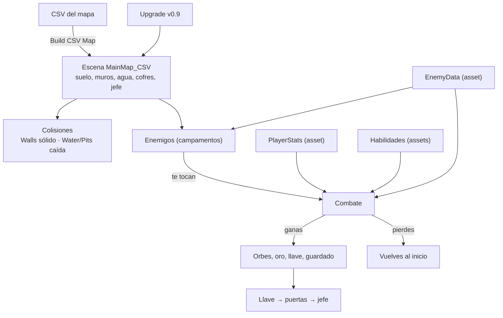

# Mictlán — Guía para cambiar, personalizar y arreglar el juego

> **Fecha:** 26 de noviembre de 2026 · **Rama:** `v0.6` (último commit `0d35fc4`; versión del juego 0.9) · **Motor:** Unity 6000.5.9f1
> Cómo está construido por dentro: [TD_Game_ARQUITECTURA.md](TD_Game_ARQUITECTURA.md) · Reglas del proyecto: [CLAUDE.md](CLAUDE.md)
> Las rutas empiezan en `Assets/TD_Game/`. «Jerarquía» se refiere a la escena `Scenes/Levels/MainMap_CSV.unity` salvo que se diga otra.

## Tabla de contenidos
1. [Referencia rápida](#1-referencia-rápida)
2. [Abrir, jugar y probar](#2-abrir-jugar-y-probar)
3. [Antes de editar: lo que NO se debe romper](#3-antes-de-editar-lo-que-no-se-debe-romper)
4. [Jugador](#4-jugador)
5. [Enemigos y jefe](#5-enemigos-y-jefe)
6. [Habilidades](#6-habilidades)
7. [Combate](#7-combate)
8. [Orbes, cofres, tiendas y llave](#8-orbes-cofres-tiendas-y-llave)
9. [Mapa (`MainMap_CSV`)](#9-mapa-mainmap_csv)
10. [NPC, diálogos, puzles y misión](#10-npc-diálogos-puzles-y-misión)
11. [Arte e importación](#11-arte-e-importación)
12. [Cámara y orden de dibujo](#12-cámara-y-orden-de-dibujo)
13. [HUD, colores y fuentes](#13-hud-colores-y-fuentes)
14. [Menús y flujo inicial](#14-menús-y-flujo-inicial)
15. [Historieta](#15-historieta)
16. [Audio y música](#16-audio-y-música)
17. [Controles e iconos de botones](#17-controles-e-iconos-de-botones)
18. [Guardado, dificultad, textos, escenas y build](#18-guardado-dificultad-textos-escenas-y-build)
19. [Cómo se conectan los sistemas (para no programadores)](#19-cómo-se-conectan-los-sistemas-para-no-programadores)
20. [Recetas paso a paso](#20-recetas-paso-a-paso)
21. [Solución de problemas](#21-solución-de-problemas)

---

## 1. Referencia rápida

| Quiero cambiar… | Ve a… |
|---|---|
| Vida, estamina, daño base, crítico, combo, Tonalli, pociones del jugador | `ScriptableObjects/Characters/PlayerStats_Tlahuelli` |
| Velocidad al caminar o correr | Jerarquía `Player` → `PlayerMovement` → **Move Speed**, **Sprint Multiplier** |
| Altura y duración del salto | `Player` → `PlayerJump` → **Jump Height**, **Air Time** |
| Daño de las caídas al agua o a los hoyos | `Player` → `PlayerHazards` → **Damage Fraction** |
| Vida, ataques, IA u oro de un enemigo | `ScriptableObjects/Enemies/EnemyData_*` |
| Dónde hay enemigos | lista `camps` en `Scripts/Editor/V09/V09WorldUpgrade.Content.cs` (y volver a ejecutar el upgrade) |
| Coste o efecto de una habilidad | `ScriptableObjects/Abilities/Ability_*` |
| Qué habilidad va en cada tecla | `Combat` → `PlayerTurn` → **Attack / Skill1 / Skill2 / Potion / Ultimate / Artifact** |
| Ventana de esquiva, PERFECT y anti-spam | `Combat` → `EnemyTurn` → **Perfect Window Fraction**, **Early Press Lockout**, **Counter Window Scale** |
| Ventana del crítico | `Ability_Attack` → **Wind Up Time**, **Critical Window** |
| Cuántos enemigos se unen a una pelea | `Combat` → `CombatManager` → **Join Radius**, **Max Enemies** |
| Zoom del mapa / del combate | `Main Camera` → Camera **Size** / `Combat` → `CombatArena` → **Combat Orthographic Size** |
| Valor de los orbes | `Combat` → `OrbSpawner` → **Soul / Health / Concentration Per Orb** |
| Precios de la tienda | `TalkArea` de cada comerciante → `MerchantShop` → **Potion Price**, **Artifact Price**, apuestas |
| Skins y sus precios | `ScriptableObjects/Items/SkinCatalog` → **Skins** |
| El mapa (terreno) | `Settings/Maps/mapa_juego_150x70.csv` + regenerar ([§9](#9-mapa-mainmap_csv)) |
| Textos de los NPC | `V09_Villagers` → `NPC_*` → `DialogueNPC` → **First Talk**, **Later Talk** |
| Consejos en pantalla | `GameFlowUI/TutorialHint` → `ContextTutorial` |
| Viñetas de la historieta | escena `TD_Prologue` → `PrologueComic` → **Pages** |
| Logo, clasificación y menú | escenas `TD_Boot` (`BootScreens`) y `TD_MainMenu` (`TitleMenu`) |
| Música y efectos | `Audio/AudioLibrary` |
| Teclas | `Settings/Input/PlayerControls.inputactions` |
| Colores de toda la UI | `Scripts/UI/MexicaPalette.cs` |

---

## 2. Abrir, jugar y probar

**Abrir el proyecto**
1. **Unity Hub → Add → Add project from disk** → la carpeta del repositorio. Usa **Unity 6000.5.9f1**.
2. Espera a que importe y revisa que la **Console** no tenga errores rojos.

**Jugar el flujo completo:** menú **Mictlan > Play From The Start** (abre `TD_Boot` y pulsa Play), o abre `Scenes/MainMenu/TD_Boot.unity` y pulsa **Play**.

**Probar una escena suelta**

| Escena | Qué pruebas |
|---|---|
| `Scenes/MainMenu/TD_Boot.unity` | logo → clasificación → descripción → menú |
| `Scenes/MainMenu/TD_MainMenu.unity` | menú, opciones y créditos |
| `Scenes/MainMenu/TD_Prologue.unity` | la historieta; al terminar carga el mapa |
| `Scenes/Levels/MainMap_CSV.unity` | **el juego**: empieza en la `S` del CSV |
| `Scenes/Testing/TestLevel.unity` | combate con 3 enemigos de prueba, sin mapa grande |

**Prueba automática:** **TD_Game > v0.9 > Run Self Test (Play Mode)** juega solo (contador, mapa, salto, caídas, campamento, tienda, diálogo, misión, guardado). El informe y las capturas quedan en `Logs/SelfTest`.

> Lo que cambies en el Inspector **durante Play Mode se pierde** al salir. Haz los cambios definitivos fuera de Play Mode y guarda la escena (**Ctrl+S**).

---

## 3. Antes de editar: lo que NO se debe romper

| Regla | Por qué |
|---|---|
| **No edites a mano los objetos `V09_*`** de `MainMap_CSV` | **TD_Game > v0.9 > Upgrade MainMap_CSV** los borra y los rehace. Cambia el builder (`Scripts/Editor/V09/`) y vuelve a ejecutarlo |
| **Tampoco muevas a mano los enemigos de `Enemies`** si vas a volver a ejecutar el upgrade | el upgrade los recrea desde la lista `camps` |
| Regenerar el mapa desde el CSV **borra** los cambios manuales de `MainMap_CSV` | `CsvMapBuilder` copia `MainMap` y rehace todo ([§9](#9-mapa-mainmap_csv)) |
| No borres ni renombres `MainMap.unity` | `CsvMapBuilder` lo usa como base |
| Los nombres de escena van en `SceneIds` (`Scripts/Managers/SceneFader.cs`) y en los campos `gameScene` / `nextScene` | si renombras una escena, el menú o la historieta no la encuentran |
| Todo el código nuevo va en `Assets/TD_Game/` con `namespace TD_Game` | convención del proyecto |
| Colores nuevos, solo de `MexicaPalette`; teclas en la UI, solo con `InputPrompts` / `ButtonGlyph` | así cambian solos con el tema y con el dispositivo |
| Si cambias el orden de `AttackEffect`, se desordenan los ataques guardados en los assets | añade valores nuevos **al final** |

---

## 4. Jugador

Jerarquía: **`Player`** (capa `Player`), con los hijos `Visual` (sprite, antorcha y macuahuitl) y `Shadow`. El prefab `Prefabs/Characters/Player.prefab` **no** lo usa ninguna escena de la build: los cambios se hacen en el `Player` de cada escena.

| Qué | Dónde | Campo | Efecto | Ojo con |
|---|---|---|---|---|
| Vida, estamina, daño | `ScriptableObjects/Characters/PlayerStats_Tlahuelli` | **Max Health**, **Max Stamina**, **Stamina Regen Fraction**, **Base Damage** | estadísticas base del combate | afecta a todas las escenas; el HUD lee estos valores |
| Pociones | mismo asset | **Starting Potions**, **Max Potions**, **Potions On Victory**, **Min Potions On Retry** | cuántas tienes y cuántas recibes | la tienda vende pociones hasta el máximo |
| Velocidad | `Player` → `PlayerMovement` | **Move Speed** (4), **Sprint Multiplier** (1.75), **Speed Change Rate** | tiles por segundo | la IA de los enemigos debe poder alcanzarte (`chaseSpeed`) |
| 8 direcciones | `PlayerMovement` | **Allow Diagonals** | desmarcado = 4 direcciones | la diagonal ya está normalizada |
| Salto | `Player` → `PlayerJump` | **Jump Height** (0.7), **Air Time** (0.55), **Cooldown**, **Ambush Window**, **Airborne Order** | altura, duración y emboscada | un salto más largo cruza más agua: los cruces de piedras se calcularon con 0.55 s |
| Caídas | `Player` → `PlayerHazards` | **Damage Fraction** (0.08), **Edge Margin**, **Safe Distance**, **Blink Seconds** | castigo y dónde reaparece | la caída nunca mata |
| Caminata | `Player` → `PlayerSpriteAnimator` | **Walk Down / Walk Up / Walk Side** (4 cuadros), **Frames Per Second** | animación al caminar | `MacuahuitlRig` convierte cada cuadro a la versión sin arma en combate |
| Sprite de combate | `Player` → `MacuahuitlRig` | **Combat Pose**, **Combat Grip** | la pose de perfil en combate | requiere **Read/Write** activado en `tlahuelli.png` |
| Macuahuitl (combate) | `MacuahuitlRig` | **Weapon Sprite** (vacío = generado), **Grip**, **Size To Body**, **Guard Angle**, **Trail Color** | arma que se ve en combate | las técnicas están en `Ability_Attack` → **Combo Swings** |
| Macuahuitl (exploración) | `Player/Visual/Macuahuitl` → `MacuahuitlSwing` | — | arma que aparece al atacar | se apaga sola en combate |
| Skins | `ScriptableObjects/Items/SkinCatalog` | **Skins**: **Id**, **Display Name**, **Price**, **Hue Shift**, **Saturation**, **Brightness** | ropa de otro color | el **Id** se guarda en la partida: no lo cambies a una skin ya vendida |
| Habilidades de inicio | `Player` → `PlayerProgression` | **Unlocked Abilities** | habilidades ya desbloqueadas | para probar; en el juego normal se ganan venciendo enemigos |

---

## 5. Enemigos y jefe

**Datos:** `ScriptableObjects/Enemies/`

| Asset | Nombre en el juego | Prefab |
|---|---|---|
| `EnemyData_Wolf` | Cuetlachtli | `Prefabs/Characters/Enemy_Wolf` |
| `EnemyData_Witch` | Tlahuelpuchi | `Enemy_Witch` |
| `EnemyData_Giant` | Quinametzin | `Enemy_Giant` |
| `EnemyData_Cihuateotl` | brujas de la misión | (las 4 de la casa) |
| `EnemyData_Quetzalcoatl` | jefe | `Boss_Quetzalcoatl` |

| Qué | Campo del `EnemyData` | Efecto |
|---|---|---|
| Nombre | **Display Name** | lo que se ve en el HUD |
| IA | **Patrol Speed**, **Chase Speed**, **Detect Radius**, **Lose Radius**, **Leash Radius**, **Patrol Radius**, **Patrol Wait**, **Alert Allies Radius** | cómo patrulla, ve y persigue |
| Combate | **Max Health**, **Attack Power**, **Damage Taken Multiplier** (<1 = piel dura), **Starts Battle First**, **Body Radius** | dureza y quién empieza |
| Ataques | **Attacks** (lista de `EnemyAttack`) | ver la tabla siguiente |
| Jefe | **Is Boss**, **Phase Two At Health**, **Phase Two Name**, **Phase Two Power Multiplier**, **Phase Two Attacks** | segunda fase; el jefe actúa 2 veces por ronda (3 en fase 2) |
| Recompensas | **Souls / Health / Concentration On Defeat**, **Gold On Defeat**, **Bonus Max Health**, **Bonus Max Stamina**, **Unlocks On Defeat**, **Last Stand Ability** | orbes, oro, crecimiento y habilidades |

**Cada ataque (`EnemyAttack`):**

| Campo | Qué hace |
|---|---|
| **Attack Name** | texto del banner |
| **Damage Multiplier**, **Hits**, **Time Between Hits** | fuerza y número de golpes |
| **Wind Up Time** | la carga: el golpe llega al final |
| **Counter Window** | segundos de la ventana de esquiva (se multiplican por **Counter Window Scale** de `EnemyTurn`) |
| **Counter** | `Dodge`, `Interrupt` (hechizos; mismo botón) o `Unavoidable` |
| **Lunge At Target** | se lanza contra Tlahuelli o dispara un proyectil |
| **Weight** | probabilidad relativa de elegir este ataque |
| **Effect**, **Effect Amount**, **Effect Ignores Counter** | `DrainStamina`, `HealSelf`, `Weaken`, `EmpowerSelf`, `LifeSteal`, `Stun`, `Guard` |

**Por enemigo en la escena** (`Enemies/Enemy_*` → `CombatEnemy`):
- **Strength**: multiplica vida y ataque (1.35–2.4 según la distancia al inicio).
- **Encounter**: id del campamento; los del mismo id pelean juntos.
- **Optional**: enemigo de misión; no cuenta para la llave.

**Sprites:** el `SpriteRenderer` del hijo `Visual` del prefab; la animación en reposo es `SpriteFlipbook`.

**Jefe:** `BossZone/Boss_Quetzalcoatl`, dentro del interior de la pirámide (sala aparte, hacia x = −220). Su arena es `BossZone/BossArena` (trigger; **Entrance Title**, **Gates** = `BossGate_2`).

**No romper:**
- Si un enemigo pierde su `EnemyData` (**Data** = None), el combate falla.
- `ObsidianKey` cuenta todos los enemigos **no opcionales** y no jefes: un enemigo inalcanzable impide conseguir la llave.

---

## 6. Habilidades

Assets en `ScriptableObjects/Abilities/`; código en `Scripts/Combat/Abilities/`.

| Asset | Tecla | Campos útiles |
|---|---|---|
| `Ability_Attack` | 1 / A | **Stamina Cost** 20, **Damage Multiplier**, **Wind Up Time** 0.55, **Critical Window** 0.2, **Perfect Fraction**, **Early Press Lockout**, **Combo Swings**, **Critical Swing** |
| `Ability_MictlanFury` | 2 / X | **Stamina Cost** 30, **Once Per Battle**, **Heal Fraction** 0.4, **Damage Multiplier** 1.5, **Turns** 3 |
| `Ability_SeismicJump` | 3 / Y | **Stamina Cost** 40, **Damage Multiplier** 1.2, coreografía (**Crouch Time**, **Jump Height**, **Rise Time**, **Hang Time**, **Slam Time**, **Spins**, **Wave Speed**, **Launch Height**) |
| `Ability_Potion` | 4 / D-pad ↑ | **Stamina Cost** 15, **Heal Fraction** 0.35 |
| `Ability_TonalliBurst` | 5 / LB | **Damage Multiplier** 2.5 (necesita Tonalli lleno) |
| `Ability_SmokingMirror` | 6 / RT | **Stamina Cost** 25, **Damage Multiplier** 1.2, **Life Steal** 0.5 (se compra en la tienda) |

Campos comunes: **Display Name**, **Description**, **Stamina Cost**, **Unlocked By Default**, **Once Per Battle**.
Las ranuras se asignan en `Combat` → `PlayerTurn`.
Fury y Seismic se ganan con **Unlocks On Defeat** de los enemigos.

**No romper:** `SaveController` → **All Abilities** debe contener todas las habilidades, o no se podrán restaurar al cargar la partida.

---

## 7. Combate

Todo en el objeto **`Combat`** de la jerarquía.

| Qué | Componente → campo | Valor | Efecto |
|---|---|---|---|
| Unirse a la pelea | `CombatManager` → **Join Radius**, **Max Enemies** | 4 / 4 | quién entra en el combate además del campamento |
| Pausa inicial | `CombatManager` → **Intro Time** | 1.2 s | banner «Battle!» |
| Ventana de esquiva | `EnemyTurn` → **Counter Window Scale**, **Boss Window Scale** | 0.75 / 0.75 | más pequeño = más difícil |
| Zona PERFECT | `EnemyTurn` → **Perfect Window Fraction** | 0.5 | parte final de la ventana |
| Anti-spam | `EnemyTurn` → **Early Press Lockout** | 0.3 s (×1.5 por pulsación extra) | castigo por pulsar antes |
| Contraataque normal | `EnemyTurn` → **Good Counter Fraction** | 0.6 | fuerza frente al PERFECT |
| Fallos del enemigo | `EnemyTurn` → **Miss Chance** | 0.1 | golpes que fallan solos |
| Paso de esquiva | `EnemyTurn` → **Dodge Step Distance** | 1 | cuánto retrocede Tlahuelli |
| Fórmula de daño | `PlayerStats_Tlahuelli` → **Base Damage**, **Critical Multiplier**, **Combo Bonus Per Hit**, **Counter Attack Multiplier**, **Charge Damage Bonus**, **Ambush Multiplier** | 14 / 1.6 / 0.15 / 0.6 / 1 / 1.2 | ver [arquitectura §5.7](TD_Game_ARQUITECTURA.md#57-combate-por-turnos) |
| Tonalli | `PlayerStats_Tlahuelli` → **Max Concentration**, **Concentration Per Perfect**, **Concentration Per Critical** | 100 / 15 / 8 | cuándo se llena el Burst |
| Estamina por turno | `PlayerStats_Tlahuelli` → **Stamina Regen Fraction** | 0.6 | cuántas acciones por turno |
| Colocación | `CombatArena` → **Battle Distance**, **Enemy Spacing**, **Clear Search Radius** | 5 / 1.6 / 6 | separación y búsqueda de un claro |
| Orden de dibujo | `CombatArena` → **Fighter Order** | 510 | debe ser mayor que la oscuridad (500) |
| Zoom | `CombatArena` → **Combat Orthographic Size**, **Zoom Time** | 4.219 / 0.4 | encuadre de la pelea |
| Pausa sin estamina | `PlayerTurn` → **Out Of Stamina Pause** | 0.7 s | — |

**No romper:**
- `PlayerTurn`, `EnemyTurn` y `CombatManager` deben apuntar a `CombatInput` y al asset `PlayerControls`.
- Si `Fighter Order` baja de 500, Tlahuelli vuelve a quedar tapado por la oscuridad.

---

## 8. Orbes, cofres, tiendas y llave

| Qué | Dónde | Campos |
|---|---|---|
| Orbes | `Combat` → `OrbSpawner` | **Orb Prefab**, **Soul Per Orb** 4, **Health Per Orb** 5, **Concentration Per Orb** 5, **Max Orbs Per Type** 4, colores |
| Aspecto e imán de un orbe | `Prefabs/Interactables/Orb.prefab` → `SoulOrb` | **Bob Height**, **Magnet Radius**, **Magnet Speed**, **Size**, sprites |
| Cuántos orbes suelta un enemigo | `EnemyData` | **Souls / Health / Concentration On Defeat** |
| Cofres | `Chests/Chest_*` y `V09_PyramidDecor/SummitOffering` → `LootChest` | **Gold**, **Potions**, **Heal**, **Title** |
| Premio del puzle | `Puzzle (Four Fires)` → `BrazierPuzzle` | **Treasure Gold**, **Correct Order** |
| Tiendas | `Merchant (Shop)/TalkArea` y `V09_Merchant (…)/TalkArea` → `MerchantShop` | **Merchant Name**, **Potion Price**, **Small Bet**, **Big Bet**, **Artifact Price**, **Artifact**, frases (**Greet / Buy / Win / Lose / Goodbye Lines**) |
| Llave de obsidiana | `ObsidianKey` | aparece cuando no queda ningún enemigo normal vivo |
| Puerta de obsidiana (antesala de la pirámide) | `ObsidianDoor_2` → `KeyDoor` | **Closed Sprite**, **Open Sprite**, **Slab Rise Time**, **Light Wave Length** |

**No romper:**
- Las 3 tiendas comparten el mismo oro y las mismas skins.
- Un cofre sin `Collider2D` con **Is Trigger** no se abre.
- Los cofres **no se guardan** en la partida: al cargar se pueden volver a abrir.

---

## 9. Mapa (`MainMap_CSV`)

**El archivo:** `Settings/Maps/mapa_juego_150x70.csv` tiene 70 filas × 150 columnas, una letra por celda separada por comas. La fila 1 es el norte. **1 celda = 2 × 2 tiles.**

| Letra | Significado |
|---|---|
| `.` | pasto |
| `C` | camino de tierra |
| `D` | arena del desierto |
| `W` | agua (peligro: Tlahuelli cae) |
| `V` | barranco (peligro) |
| `T` | árbol (sólido) |
| `P` | muro de la pirámide (sólido) |
| `M` | muro de la pirámide (sólido) |
| `I` | pasillo de la pirámide |
| `S` | inicio de Tlahuelli (solo una) |
| `K` | cofre |
| `H` | casa de las brujas (antes, casa de la espada) |
| `E` | marca del diseño; **ya no coloca enemigos** (ver abajo) |
| `R` | roca: borde que no se puede cruzar (sólido) |
| `X` | fuera del mapa: no se pinta nada (la antigua cueva y el desierto al este) |

**Cómo regenerar el mapa** (borra los cambios hechos a mano en la escena):
1. Edita el CSV y guárdalo con el mismo nombre.
2. Borra `Scenes/Levels/MainMap_CSV.unity` (haz una copia antes si tiene cambios a mano).
3. **TD_Game > Build CSV Map (MainMap_CSV)**: copia `MainMap`, pinta el CSV y coloca jugador, cofres, casa, jefe, puertas, tienda y puzle. La consola informa si se llega a todo desde la `S`.
4. **TD_Game > v0.9 > Upgrade MainMap_CSV**: añade peligros, puentes, pirámide, enemigos, NPC, tiendas y casa de las brujas.
5. Guarda la escena y prueba en Play Mode.

**Qué controla cada cosa**

| Quiero… | Cómo |
|---|---|
| Mover o añadir enemigos | edita la lista `camps` (celda del CSV + tipos) en `Scripts/Editor/V09/V09WorldUpgrade.Content.cs` y vuelve al paso 4 |
| Un puente nuevo | el upgrade elige puentes y cruces de piedras solo; para uno fijo, `BridgeCells` en `Scripts/Editor/CsvMapPainter.cs` |
| Pintar a mano | **Window > 2D > Tile Palette** sobre `Grid/Ground` (suelo), `Grid/Walls` (sólido), `Grid/Water` o `Grid/Pits` (peligro, capa `Hazard`). Se pierde si regeneras |
| Que algo sea sólido | ponlo en `Walls`, o dale un `BoxCollider2D` no trigger |
| Que algo se pueda saltar | capa `LowObstacle` + `BoxCollider2D` |
| Un borde invisible | `MapBorder` (4 `BoxCollider2D` alrededor de 250×140: el mapa jugable son las columnas 0–124, `CsvMap.PlayableColumns`) |
| Mover la casa de las brujas | mueve la `H` del CSV (la casa de las brujas ocupa su lugar; la casa de la espada ya no se crea) |
| Cerrar el paso | pon `T` (árboles) o `R` (rocas) en el CSV; las líneas deben tocar agua, otro borde o el límite del mapa para no dejar huecos |
| Interior de la pirámide | se diseña en el CSV (columnas 102–143, filas 1–34) y el upgrade lo saca del mapa a una sala aparte (`V09_PyramidInterior`, `V09WorldUpgrade.Layout.cs`). Se entra por la boca de serpiente de la cima; la puerta de obsidiana está en la antesala |
| Nombres de región | `Territories/Zone_*` → `ZoneArea` → **Zone Name**, **Subtitle**, y el tamaño del `BoxCollider2D` |

**No romper:**
- La cámara y el minimapa usan los bordes de `Ground`.
- El jefe solo debe ser alcanzable a través de una `KeyDoor`.
- `PlayerHazards` lee `Water` y `Pits` por nombre.

---

## 10. NPC, diálogos, puzles y misión

| Qué | Dónde | Campos |
|---|---|---|
| Aldeanos | `V09_Villagers/NPC_*` → `DialogueNPC` | **Npc Name**, **Id** (se guarda), **First Talk**, **Later Talk** (las líneas con `> ` las dice Tlahuelli), **Portrait** |
| Objetos que se leen | `InteractSpot` (glifos del santuario, pintura) | **Lines** |
| Caja de diálogo | `V09_Dialogue` → `DialogueBox` | aspecto de la caja |
| Puzle de los cuatro fuegos | `Puzzle (Four Fires)` → `BrazierPuzzle` | **Correct Order**, **Treasure Gold** |
| Entrada a la pirámide | `V09_PyramidInterior/Door (pyramid, outside)` (boca de serpiente de la cima) y `Door (pyramid, inside)` (salida de la antesala) → `HouseDoor` | destino, **First Time Banner** |
| Misión de las brujas | `V09_WitchHouseInside` → `WitchHouseQuest` | **Witches**, **Speed Bonus** 1.3, textos (**While Guarded**, **After Witches**, **Story**, **After Reward**) |
| Rompecabezas de la pintura | `V09_WitchHouseInside` → `PaintingPuzzle` | **Picture**, **Columns** 3, **Rows** 3, **Title**, **Caption** |
| Puertas de casas | `Door (outside)` / `Door (inside)` → `HouseDoor` | destino al otro lado |
| Marcas en el mapa (M) | `MapMarker` en cada objeto | icono y nombre en el mapa completo |

**No romper:** el **Id** de un NPC y los ids de la misión (`witch_puzzle_solved`, `painal_freed`) se guardan; si los cambias, las partidas viejas no los reconocen.

---

## 11. Arte e importación

El estilo del juego es **pixel art de 16 px por tile** (1 tile = 1 unidad de Unity). Configuración de importación de cada PNG (Inspector → **Apply**):

| Ajuste | Tiles | Personajes y objetos |
|---|---|---|
| Texture Type | Sprite (2D and UI) | Sprite (2D and UI) |
| Sprite Mode | Single | Multiple si es una hoja de sprites |
| **Pixels Per Unit** | **16** (el del resto del arte del mapa) | 16 (Tlahuelli y props) |
| Pivot | Center | **Bottom** (los pies) |
| **Filter Mode** | **Point (no filter)** | **Point (no filter)** |
| **Compression** | **None** | **None** |
| Generate Mip Maps | Off | Off |

> El arte del equipo de v0.9 en `Art/Environment/Team` (rocas, árboles, niebla) se usa a **40 PPU**, tal como está dibujado (`PropArt.V09Team`). Al reemplazar un PNG, copia el PPU del archivo anterior: sus originales sin usar (`*_original.png`) están a 100.

| Quiero cambiar… | Dónde |
|---|---|
| Tiles del suelo, agua y templo | `Art/Tilesets/Mictlan/` (generados por `TerrainArt` y el upgrade). Reemplaza el PNG con el mismo nombre y tamaño |
| Pasto y árboles de Vely | `Art/Tilesets/Vely/` |
| Props (tienda, pirámide, braseros, NPC) | `Art/Props/` |
| Personajes | `Art/Characters/` (Tlahuelli: hoja de 3 filas × 4 cuadros) |
| Efectos (oscuridad, brillos, sangre) | `Art/Effects/` |
| Marcos y grecas de la UI | `Art/UI/` |

**No romper:**
- Las herramientas **TD_Game > Generate Map Tiles / Generate Props And Comic Art / Generate Menu Frame And Darkness** **sobrescriben** los PNG generados: si reemplazaste uno a mano, no las vuelvas a ejecutar.
- `tlahuelli.png` necesita **Read/Write** activado (lo usa `MacuahuitlRig`).

---

## 12. Cámara y orden de dibujo

| Qué | Dónde | Valor |
|---|---|---|
| Zoom del mapa | `Main Camera` → Camera → **Size** | 6.75 |
| Suavizado | `Main Camera` → `CameraFollow` → **Smooth Time** | 0.15 |
| Límites | `CameraFollow` → **Bounds Tilemap** | `Ground` |
| Píxeles nítidos | `CameraFollow` → **Snap To Pixel Grid**, **Pixels Per Unit** | activado |
| Zoom en combate | `Combat` → `CombatArena` → **Combat Orthographic Size** | 4.219 |
| Oscuridad | `Main Camera/Darkness` → SpriteRenderer | orden 500 |

**Regla de profundidad:**
- Con el mismo *Order in Layer*, lo que está **más abajo en pantalla se dibuja delante** (*Project Settings > Graphics > Transparency Sort Mode = Custom Axis (0, 1, 0)* y *Sprite Sort Point = Pivot*).
- Hay una sola Sorting Layer (**Default**). La tabla completa de órdenes está en [arquitectura §8](TD_Game_ARQUITECTURA.md#8-orden-de-dibujo-y-pipeline-de-arte).

| Para que algo… | Haz esto |
|---|---|
| se ordene con Tlahuelli | orden 0, pivote en la base, *Sort Point = Pivot* |
| quede siempre en el suelo | orden negativo (charcos, sombras) |
| brille sobre la noche | orden 501 o más |
| no tape a los luchadores en combate | ya ocurre: van a 510 durante la pelea (`CombatArena.Raise`) |

---

## 13. HUD, colores y fuentes

| Qué | Dónde |
|---|---|
| Panel de vida, estamina y Tonalli | `CombatHUD/PlayerStatus` (`PlayerStatusPanel`, barras `UIBar`) |
| Menú de comandos | `CombatHUD/CombatGroup/CommandMenu` (`CombatActionMenu` + filas `ActionButton`) |
| Barra DEFEND | `CombatHUD/CombatGroup/EnemyTurnBar` (su texto lo pone `CombatActionMenu` según el dispositivo) |
| Orden de turnos | `CombatHUD/CombatGroup/TurnOrder` |
| Barras de enemigos | `CombatHUD/CombatGroup/EnemyBars` |
| Mensajes y números | `CombatHUD/Messages` (`CombatMessages`) |
| Minimapa, oro, avisos, título de zona, caja de esquiva, «Enemies Left» | `MapUI` |
| Consejos, Game Over, créditos | `GameFlowUI` |
| **Colores** de toda la UI | `Scripts/UI/MexicaPalette.cs` (Obsidian, Bone, Ash, AgedGold, Ochre, Cinnabar, Tezontle, Blood, Jade, Turquoise…) |
| **Fuente** | `Art/Fonts/PirataOne-Regular` (campo **Menu Font** de menús, pausa, mapa, puzle) |

**Reconstruir el HUD de combate:** borra `CombatHUD` y usa **TD_Game > Build Combat HUD**. Los cambios que hiciste a mano en él se pierden.

---

## 14. Menús y flujo inicial

| Qué | Dónde | Campos |
|---|---|---|
| Logo del estudio | escena `TD_Boot` → `BootScreens` | **Studio Logo**, **Studio Name**, **Logo Seconds** |
| Pantalla de clasificación | `BootScreens` | **Rating Image**, **Rating Letter**, **Rating Label** |
| Descripción del juego | `BootScreens` | **Description Title** y textos |
| Menú principal | escena `TD_MainMenu` → `TitleMenu` | **Background**, **Game Logo**, **Title**, **Studio**, **Version**, **Game Scene**, **Prologue Scene**, **Menu Font** |
| Créditos del menú | `Scripts/UI/TitleMenu.cs` (constante `TeamCredits`) | requiere editar código |
| Créditos finales | `Scripts/UI/CreditsScreen.cs` (constante `EndCredits`) y `GameFlowUI/CreditsScreen` | requiere editar código |
| Pausa | jerarquía `PauseScreen` → `PauseScreen` | **Main Menu Scene**, **Menu Font** |

El orden del menú (Start Game, Continue, Options, Credits, Exit) y las opciones se construyen en código (`MenuWidgets`).

---

## 15. Historieta

Escena `TD_Prologue` → objeto `PrologueComic`:

| Campo | Efecto |
|---|---|
| **Pages** → **Panels** | cada viñeta: **Picture** (imagen de `Art/Comic`), **Crop** (parte de la imagen), **Tint**, **Caption** (texto) |
| **Next Scene** | escena al terminar (`MainMap_CSV`) |
| **Hint Idle Seconds** | segundos sin tocar nada hasta que la ayuda se oculta (3) |
| **Skip Hold Seconds** | cuánto mantener ESC / B para omitir (1) |
| **Panel Fade Seconds** | duración de la aparición de cada viñeta (0.5) |
| **Menu Font** | fuente de los textos |

Las teclas de Siguiente (Espacio, Enter, clic, A) y Omitir (ESC, B) están en el código de `Scripts/UI/PrologueComic.cs` (`NextPressed`, `SkipHeld`).

---

## 16. Audio y música

| Qué | Dónde |
|---|---|
| Canciones (menú, exploración, batalla, jefe, game over) y efectos | `Audio/AudioLibrary` → **Menu**, **Explore**, **Battle**, **Boss**, **Game Over** y **Sfx** (cada efecto: **Name**, **Clip**, **Volume**, **Variants**) |
| Archivos | `Audio/Music`, `Audio/SFX`, `Audio/Voice` (comerciante) |
| Música de cada escena | objeto `GameAudio` → **Scene Music** |
| Mezcla | `GameAudio` → **Cross Fade Seconds**, **Sfx Voices**, **Min Repeat Seconds**, **Voice Volume** |
| Ambiente | `V09_Ambience` → `AmbientSoundscape` → **Forest**, **River**, **Desert Wind**, **Interior**, **Volume**, **Battle Volume** |
| Volumen del jugador | menú Options y pausa (se guarda en `PlayerPrefs`) |

**Cambiar un sonido:** reemplaza el clip en `AudioLibrary` (o el archivo con el mismo nombre). El código pide los efectos **por nombre** (`GameAudio.PlaySfx("dodge")`): no cambies el nombre de una entrada de **Sfx**.
**TD_Game > Audio > Generate Sounds** vuelve a generar los sonidos sintetizados y **sobrescribe** esos archivos.

---

## 17. Controles e iconos de botones

**Teclas:** abre `Settings/Input/PlayerControls.inputactions` (doble clic) → selecciona la acción → **+** para añadir un binding, o selecciónalo y **Delete** para quitarlo → **Save Asset**.

| Mapa | Acciones |
|---|---|
| `Player` | `Move`, `Jump`, `Sprint` |
| `Combat` | `Attack`, `Skill1`, `Skill2`, `Potion`, `Ultimate`, `Artifact`, `EndTurn`, `TargetPrev`, `TargetNext`, `Dodge`, `Interrupt` (sin uso) |

Interactuar (E / Y), el mapa (M, Tab / View), la pausa (ESC / Start) y los menús se leen **en código** (ver [arquitectura §5.2](TD_Game_ARQUITECTURA.md#52-input-y-detección-de-dispositivo)).

**Iconos de botones:**
- **Nombre que muestra cada acción:** tabla `Actions` en `Scripts/UI/InputPrompts.cs`, con teclado y Xbox; PlayStation se deduce de Xbox (A → CROSS…). Si cambias una tecla en el `.inputactions`, cambia también aquí su nombre.
- **Dibujo de los iconos:** `Scripts/UI/ButtonGlyphs.cs` (tecla, placa, botón redondo, ✕ ○ □ △, ratón), en pixel art generado en código.
- **Modo:** el jugador lo elige en Options / pausa → **Button icons**: Auto, Keyboard, Xbox o PlayStation.
- **En textos:** escribe `{Acción}`, por ejemplo «Press {Dodge}». `InputPrompts.Localize` lo cambia por `[SPACE]`, `[B]` o `[CIRCLE]`.

**No romper:**
- Si cambias el nombre de una acción del `.inputactions`, revisa las referencias en `Player` → `PlayerInputReader` y en `CombatInput`.
- No escribas teclas fijas («Press E») en la UI.

---

## 18. Guardado, dificultad, textos, escenas y build

**Guardado**
- Archivo `td_game_save.json` en `Application.persistentDataPath` (en Windows, `%USERPROFILE%\AppData\LocalLow\Micta Forge\Mictlan`).
- Se guarda tras cada victoria, al comprar y al terminar la misión de las brujas.
- **Para empezar limpio:** New Game borra la partida; también puedes borrar el archivo a mano.
- `SaveController` → **Always Load In Editor**: carga la partida al pulsar Play en el editor, para probar.

**Dificultad**
- No hay selector de dificultad.
- **Por enemigo:** `CombatEnemy` → **Strength**.
- **Por tipo de enemigo:** `EnemyData`.
- **De la esquiva:** `EnemyTurn` → **Counter Window Scale**.

**Textos**

| Textos | Dónde |
|---|---|
| Consejos | `GameFlowUI/TutorialHint` → `ContextTutorial` (**Start Hint**, **Quick Time Dodge Hint**, **Exploration Tips**…). Usa `{Acción}` para los botones |
| Pistas por zona | `TutorialZone` → **Message** |
| NPC | `DialogueNPC` |
| Tiendas | `MerchantShop` |
| Fin del juego | `CreditsScreen.cs` |

**Escena nueva**
1. Duplica `MainMap_CSV` (Ctrl+D en *Project*).
2. Añádela en **File > Build Profiles** (Scene List).
3. Para que el juego la cargue, cambia `SceneIds.MainMap` en `Scripts/Managers/SceneFader.cs` y los campos **Game Scene** de `TitleMenu` y **Next Scene** de `PrologueComic`.

**Build (.exe)**
- **Mictlan > Build Game For Friends (.exe)** crea `Builds/Mictlan/Mictlan.exe`.
- **Build Settings** incluye también `MainMap` y `TestLevel`, que el juego no carga; puedes desmarcarlas en *Build Profiles* para reducir el tamaño.

---

## 19. Cómo se conectan los sistemas (para no programadores)

- **El CSV decide el terreno:** dónde hay suelo, agua, árboles y pirámide. Si cambias una `W` por un `.`, ahí deja de haber agua (y Tlahuelli ya no cae) después de regenerar.
- **Los assets alimentan al mapa y al combate a la vez:** un `EnemyData` controla cómo patrulla un enemigo en el mapa **y** cómo pelea. `PlayerStats` controla la vida que ves en el HUD **y** el daño que haces.
- **El combate no conoce la pantalla:** avisa por eventos y la UI, el sonido y la cámara reaccionan. Por eso puedes cambiar el HUD sin romper el combate.
- **El semáforo `GameState`:** si algo pone el juego en `Cutscene` (diálogo, tienda, mapa) y no lo devuelve a `Exploration`, el jugador no se puede mover.

---

## 20. Recetas paso a paso

**Hacer un enemigo más fuerte**
1. Abre `ScriptableObjects/Enemies/EnemyData_Giant`.
2. Sube **Max Health** o **Attack Power**.
3. Prueba en Play Mode: afecta a **todos** los gigantes.

**Crear un tipo de enemigo nuevo**
1. Clic derecho en `ScriptableObjects/Enemies` → **Create > TD_Game > Enemy Data**. Rellena nombre, vida, IA y **Attacks**.
2. Duplica un prefab de `Prefabs/Characters` (por ejemplo `Enemy_Witch`), asígnale el nuevo asset en `CombatEnemy` → **Data** y cambia el sprite de `Visual`.
3. Colócalo en `Enemies` de la escena, o añádelo a la lista `camps` del upgrade de v0.9 (con su nombre de prefab).

**Crear una habilidad nueva**
1. Crea `Scripts/Combat/Abilities/MiHabilidad.cs` que herede de `CombatAbility`, con `[CreateAssetMenu]`, e implementa `Execute`.
2. Crea su asset en `ScriptableObjects/Abilities`.
3. Asígnalo a una ranura de `Combat` → `PlayerTurn`.
4. Añádelo a `SaveController` → **All Abilities**.

**Hacer la esquiva más fácil**
1. `Combat` → `EnemyTurn` → **Counter Window Scale**: de 0.75 a 1.
2. Si quieres castigar menos el spam, baja **Early Press Lockout** a 0.2.

**Cambiar el texto de un aldeano**
1. Selecciona `V09_Villagers/NPC_<nombre>`.
2. Edita `DialogueNPC` → **First Talk** / **Later Talk**.
3. **Ojo:** se pierde si vuelves a ejecutar el upgrade de v0.9. Para que dure, cambia el texto en `Scripts/Editor/V09/V09WorldUpgrade.Content.cs`.

**Añadir una viñeta a la historieta**
1. Importa la imagen en `Art/Comic` (Point, sin compresión).
2. Escena `TD_Prologue` → `PrologueComic` → **Pages** → **+** en **Panels** → asigna **Picture** y **Caption**.

**Cambiar un precio de la tienda**
1. Selecciona el `TalkArea` de cada comerciante (`Merchant (Shop)` y `V09_Merchant (…)`).
2. Cambia **Potion Price** o **Artifact Price** en los cuatro.

---

## 21. Solución de problemas

| Problema | Causa | Solución |
|---|---|---|
| Errores rojos al abrir el proyecto | importación incompleta o versión de Unity distinta | usa Unity 6000.5.9f1; *Assets > Reimport All* |
| Tlahuelli no se mueve | la ventana Game no tiene el foco, o el juego quedó en `Cutscene` | haz clic en la ventana Game; revisa que el diálogo, tienda o mapa se haya cerrado |
| El mando no responde o no cambian los iconos | el mando no envía eventos al Input System, u **Options → Button icons** no está en Auto | prueba el mando en *Window > Analysis > Input Debugger*; pon **Auto** |
| El pixel art se ve borroso | importación incorrecta | Filter **Point**, Compression **None**, el PPU correcto ([§11](#11-arte-e-importación)) |
| Tlahuelli queda tapado en combate | **Fighter Order** de `CombatArena` menor de 500, o un objeto con orden mayor | deja **Fighter Order** en 510 |
| Un campo dice **Missing** o **None** en el Inspector | se borró o renombró el asset referenciado | vuelve a asignarlo; si es del HUD, reconstrúyelo (**TD_Game > Build Combat HUD**) |
| Desaparecieron cambios en `V09_*` o en los enemigos | se volvió a ejecutar **Upgrade MainMap_CSV** | haz esos cambios en el código del builder |
| El mapa regenerado no tiene enemigos, NPC ni pirámide nueva | solo se ejecutó **Build CSV Map** | ejecuta también **TD_Game > v0.9 > Upgrade MainMap_CSV** |
| **Build CSV Map** no hace nada | `MainMap_CSV` ya existe | bórrala primero (haz una copia si tiene cambios a mano) |
| Continue está desactivado | no hay partida, o se terminó el juego (el final borra la partida) | empieza con New Game |
| Los orbes no se recogen | sigues en combate | se recogen al volver a explorar |
| No aparece la llave | queda algún enemigo normal vivo | mira «Enemies Left» abajo a la derecha y el mapa (M) |
| No encuentro la entrada de la pirámide | se entra por arriba | sube la escalinata hasta la boca de serpiente del santuario, en la cima |
| El minimapa no vuelve al salir de una casa | versión anterior al 26 nov (`HouseDoor` no encontraba el minimapa oculto) | ya está corregido; si pasa, revisa que `MapUI/Minimap` exista en la escena |
| Una barrera del CSV deja pasar | la línea de `T` o `R` no toca agua, otro borde o el límite del mapa | cierra el hueco en el CSV y vuelve a ejecutar el upgrade |
| Claude no conecta con Unity (MCP) | el puente MCP se detuvo | en Unity, *Window > MCP for Unity > Start Server*; luego, en Claude, reconectar el servidor MCP |
| El Play Mode va a saltos cuando Unity no tiene el foco | Unity en segundo plano | dale el foco a Unity (en pruebas por MCP: `Application.runInBackground = true`) |
